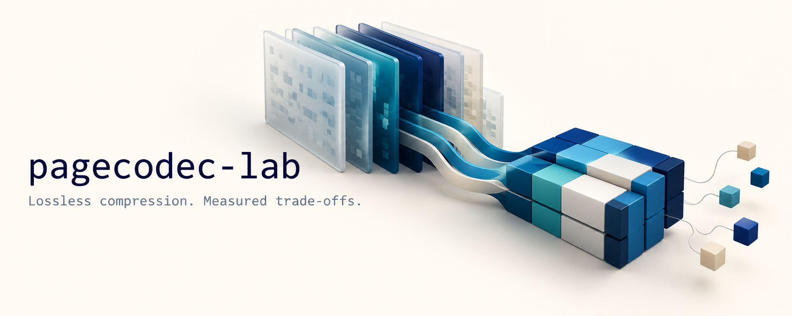
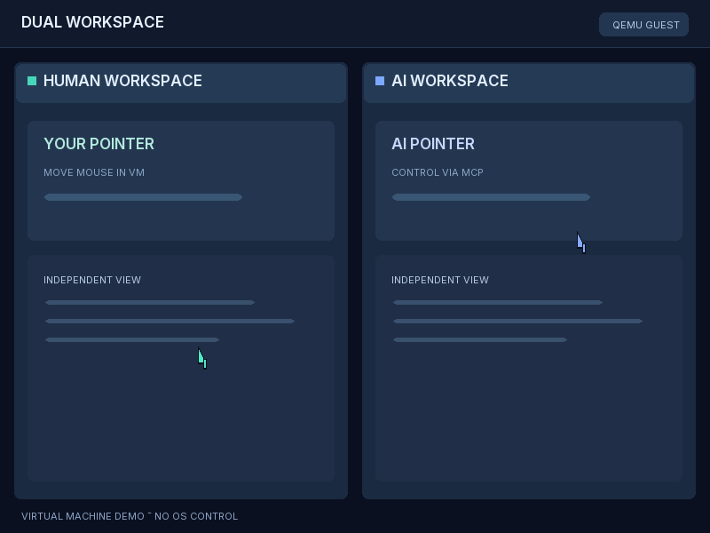
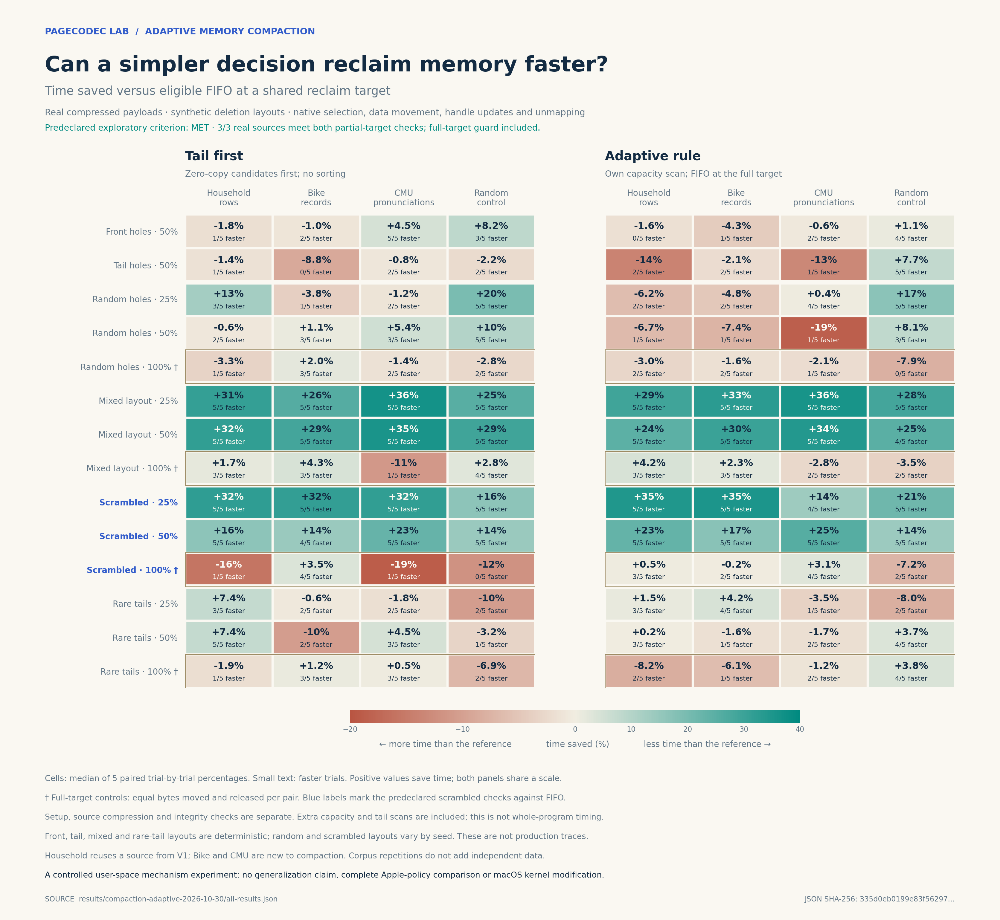
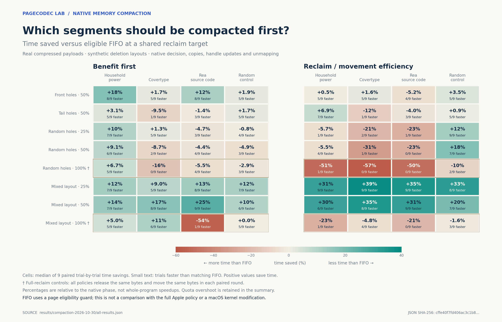
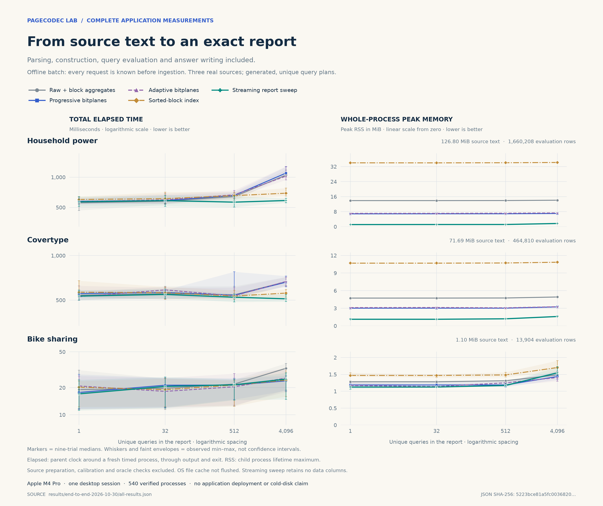
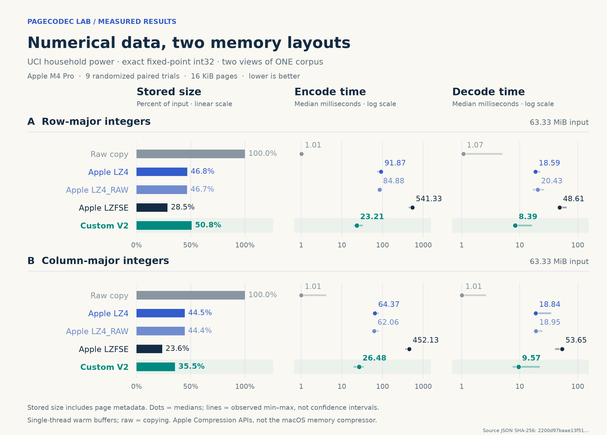
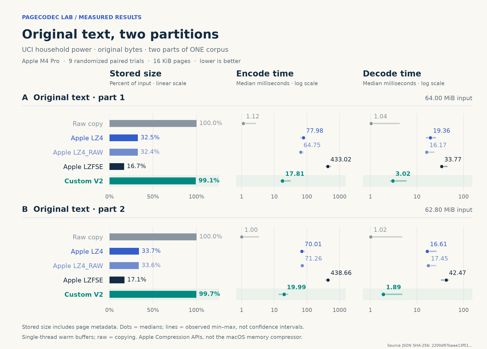

[](https://github.com/nicolashedoire/pagecodec-lab/actions/workflows/ci.yml)
[](LICENSE)

# pagecodec-lab

Experiments in exact data representations and native memory-management mechanisms: compressed-segment compaction, a C page codec benchmarked against Apple's **LZ4, LZ4_RAW and LZFSE**, and C++ prototypes for operations on compact data. Code, real-data preparation, timing samples, failures and measured charts are included.

The prototypes operate on caller-owned memory. A separate REA/Ghidra investigation inspects the local ARM kernel image and matching public XNU sources. These experiments do not redesign DRAM, replace the macOS memory compressor, or establish general superiority to Apple.

For the broader OS direction, see the [existing-project landscape and proposed system architecture](docs/SYSTEM_LANDSCAPE.md), and the [detailed comparison, driver dependencies and primary sources](docs/PROJECT_COMPARISON.md).
For a mechanism-by-mechanism foundation, see the [deep macOS architecture and alternative design](docs/DEEP_ARCHITECTURE.md).
For proposed AI control interfaces and decision models, see the [MCP and neural decision control plane](docs/AI_CONTROL_PLANE.md).
The proposed user interface includes a [floating voice assistant](docs/VOICE_ASSISTANT.md) and [separate human and AI workspaces](docs/DUAL_WORKSPACES.md). A [local decision-model demo](experiments/local_decision/README.md) is available; it runs Laya, not Jev.

Development of the proposed system now uses [Rust and a VM-first test plan](docs/RUST_SYSTEM.md). The first [workspace core](experiments/system_core/README.md) is user-space code; it is not a bootable operating system.

The [integrated prototype roadmap](docs/PROTOTYPE_ROADMAP.md) records the current VM baseline and the work still required for a usable system.

The [dual-pointer VM experiment](experiments/dual_pointer_display/README.md) boots a minimal Rust guest, draws its own screen, receives virtual tablet input and exposes a small MCP server for moving the second pointer and editing synthetic document copies. The panels are graphical mockups, not isolated workspaces or applications. The newer [integrated guest](experiments/workspace_dynamic_storage/VFS.md) also routes a virtual keyboard to a focused process-owned surface; codes are raw input events, without text layout or IME. A [reproducible QEMU run](experiments/dual_pointer_display/README.md#repeat-the-end-to-end-demonstration) records synthetic input and the MCP exchange. [Native Apple Silicon boot research](docs/NATIVE_BOOT_RESEARCH.md) documents the work still needed before any physical installation.

The separate [extensible actor registry](experiments/actor_core/README.md) models multiple participants and pointers. A [workspace bridge](experiments/workspace_bridge/README.md) connects actor labels to two document copies and a deterministic merge; it does not yet use AI to resolve conflicts. The [VM integration contracts](docs/VM_INTEGRATION_CONTRACTS.md) describe how the pieces might connect and what is still missing.

The [frame allocator model](experiments/memory_core/README.md) exercises reservations and allocation on synthetic addresses. A [VM arena experiment](experiments/memory_arena/README.md) applies it to a guest-owned static array and checks actual guest reads and writes; neither initializes an MMU or manages real Mac memory.

Other VM experiments test a [logical FIFO scheduler](experiments/scheduler_core/README.md) and a [controlled AArch64 synchronous exception](experiments/interrupt_core/README.md). They do not yet provide process execution, context switching or hardware interrupt handling.

Separate guests demonstrate [cooperative stack and integer-register switching](experiments/cooperative_tasks/README.md), [scheduler-selected cooperative tasks](experiments/cooperative_scheduler/README.md) and a [controlled virtual timer interrupt](experiments/arm_timer/README.md). These narrow demonstrations are not integrated into a preemptive scheduler and do not establish process isolation.

Another guest [enables a small ARM virtual-memory map](experiments/virtual_memory/README.md) in QEMU; a [separate protection-fault experiment](experiments/virtual_memory_faults/README.md) tests a controlled write fault against a writable control. The [preemptive blocking prototype](experiments/preemptive_blocking/README.md) tests two fixed tasks, a scripted wakeup and an idle context using a virtual timer. The [preemption research](docs/PREEMPTIVE_SCHEDULING_RESEARCH.md) records the remaining work toward a general scheduler. [Local model research](docs/LOCAL_MODEL_RESEARCH.md) describes the runtime and memory work still required for inference inside the guest.

The [VirtIO negotiation experiment](experiments/virtio_negotiation/README.md) examines a feature-acceptance gap using a simulated refusal and a QEMU device. A [separate experimental local patch](experiments/virtio_fix/README.md) tests the change with the RNG driver; some guests now use that patch, while others still use the original dependency. Full driver conformance remains unproven.

The [dynamic multi-actor pointer router](experiments/dynamic_input/README.md) drives three visible pointers in the graphical demo. A separate [graphical recovery prototype](experiments/graph_crash_recovery/README.md) tests two snapshot slots over VirtIO in QEMU; it does not yet guarantee recovery from a power failure.

The [interactive graphics prototype](experiments/graph_interaction/README.md) adds synthetic clickable controls and independent logical focus. The [EL0 guest experiment](experiments/user_mode/README.md) tests a controlled user-mode call and a denied kernel-page access; a separate [bounded IPC dispatcher](experiments/ipc_service/README.md) exercises messages between two user spaces. Neither establishes complete process isolation or general IPC. See the [user-mode research](docs/USER_MODE_RESEARCH.md).

The [integrated workspace guest](experiments/workspace_dynamic_storage/README.md) combines fixed EL0 tasks with separately mapped code and private data, a bounded FIFO, virtual graphics and task-requested snapshots. It loads two programs from a restricted AArch64 ELF subset on its virtual disk into separate read/execute pages; one writes and reads a synthetic file through the FIFO. Its [bounded file service](experiments/workspace_dynamic_storage/VFS.md) persists named files alongside workspace data. An ELF that passes structural checks can still halt or hang the guest if it does not follow the fixture ABI; the MCP endpoint is unauthenticated. This is not a general process subsystem, POSIX filesystem or security boundary. See [how to launch the integrated VM](docs/UNIFIED_VM.md).

The same guest can also [admit two loaded ELF tasks at once](experiments/workspace_dynamic_storage/VFS.md#two-loaded-processes), each with its own code and data frames, and time-slice them on one virtual CPU. Each task can use bounded file IPC with separate request state and an experimental namespace restriction. This scripted path is not a general process manager, authentication scheme or production access-control model.

The [interleaved system VM](experiments/concurrent_isolation/README.md) runs two EL0 loops in separate page tables between graphical service operations and tests synthetic two-slot snapshots in one QEMU image. A separate [process-isolation experiment](experiments/process_isolation/README.md) tests controlled forbidden reads. These scenarios do not yet establish complete process isolation or native hardware support. See the [kernel integration research](docs/KERNEL_INTEGRATION_RESEARCH.md).

A [tiny synthetic neural inference experiment](experiments/local_inference/README.md) runs in QEMU and is exposed for diagnostic scoring in a [journal-enabled MCP guest](experiments/journal_vm/README.md). A separate [model loader](experiments/local_model_loader/README.md) reads a tiny synthetic model from a virtual disk. These hand-written weights are neither Jev nor Laya and do not control the system. The journal records only specified synthetic inference outcomes, not all system I/O or real user data.



## New: adaptive compaction follow-up

An adaptive rule selects segments with trailing holes first, but falls back to
FIFO when the entire reclaimable pool is required. In 1,456 fresh processes,
the prespecified exploratory criterion passed for all three real inputs: on
seeded mixed layouts, median paired phase times were 13.72–35.02% lower than
FIFO at partial quotas, without a full-quota regression exceeding 10%.
The rule still lost in other cases: on the dictionary with random holes and a
50% quota it was 18.54% slower than FIFO. These are five-round medians in a
user-space arena with synthetic deletions, not an improvement demonstrated in
the macOS kernel. Repeated small inputs are not independent workloads.



[Methods and limitations](docs/ADAPTIVE_COMPACTION.md) ·
[All samples and summary](results/compaction-adaptive-2026-10-30/) ·
[Comparison with efficiency sorting](assets/compaction-adaptive-versus-efficiency.png) ·
[Apple reverse-engineering tools](docs/APPLE_REVERSE_TOOLS.md).

## Earlier: a native memory-compaction experiment

**Choosing which segments to compact can avoid real copies and release actual
pages—but a more elaborate ranking can also make the operation slower.** After
locating a compaction decision in the ARM kernel with REA and Ghidra, we built a
user-space arena that performs native `memmove`, handle updates and `munmap`.
Its FIFO reference includes a one-page eligibility guard and starts at the first
hole, following the relevant mechanisms in Apple's public source.

The frozen run has **1,120 fresh processes**, about **96 MiB of compressed
payload per pool**, three real corpora plus a random-byte control, and synthetic
deletion layouts. On mixed layouts with a 25% reclaim quota, efficiency ordering
saves **30.59–38.55% of phase time** on the three real corpora and wins **9/9**
repetitions each. It does this by selecting trailing holes that can be released
with no payload copies. The repeated copies of small corpora do not create new
independent data.

**Negative result:** on Covertype with random holes and a full reclaim quota,
the same rule takes **57.01% more time**, losing **9/9**, despite moving and
releasing the same number of bytes as FIFO. These are median paired changes,
not an overall Mac speedup. No learned model is involved; the follow-up above
tests cheaper tail-first and adaptive references.



[Full results and limitations](docs/COMPACTION.md) ·
[REA/Ghidra evidence and Apple safeguards](docs/NATIVE_MEMORY.md) ·
[1,120 process measurements](results/compaction-2026-10-30/process-samples.csv) ·
[Observed resident-memory recovery](assets/compaction-costs.png).

The next system-level investigation examines the Mac's active Edge scheduler,
its existing statistical estimates and a source-grounded migration decision.
See [scheduler research and limitations](docs/SCHEDULER_RESEARCH.md).

## Earlier: a complete application, including construction and peak RSS

**An offline analytical report can finish faster and use less peak memory by
answering its known questions during one source pass.** We implemented five
strategies and measured 540 fresh processes, from original source text and a
supplied query plan through complete JSON answers. Parsing, construction,
projection verification, queries, writing and process startup/exit all count.

At 4096 unique questions, the streaming endpoint sweep versus raw NEON with
block aggregates gives:

| Source | Complete elapsed time | Whole-process peak RSS |
|---|---:|---:|
| Household electricity | 1048.95 → **585.73 ms** (−44.16%) | 14.094 → **1.703 MiB** (−87.92%) |
| Covertype forest observations | 665.29 → **510.35 ms** (−23.29%) | 4.922 → **1.594 MiB** (−67.62%) |

These are nine-trial medians. Both gains exceed 10% in all nine paired rounds
on each source. The sweep also has the best measured elapsed median and RSS
among all five strategies on those two large reports. Against the faster
sorted-block control, its time advantage is 15.45% and 8.49%, respectively.



**Limits and negative results:** every report question is known before reading;
this is not an interactive store. At low query counts, parsing dominates and the
sweep can be slower. It uses 4.21% more peak RSS than raw on the small Bike report.
The bitplane variants save memory but **do not meet the predeclared two-source
end-to-end speed-and-memory criterion**. Queries are generated plans over real
data, measured in one warm-file-cache desktop session, not production traffic.

[Full results, all controls and reproduction](docs/END_TO_END.md) ·
[Runnable report application](experiments/end_to_end/README.md) ·
[540 process samples](results/end-to-end-2026-10-30/process-samples.csv) ·
[Actual report answers](results/end-to-end-2026-10-30/reports).

## Earlier: three operation-level experiments

**The most promising result is querying exact compressed values without reconstructing entire arrays.** On Covertype forest observations, progressive bitplanes use **55.49% less accounted working capacity** and achieve **1.18–2.00× ratios of median query times** against a native ARM NEON raw baseline, across all nine tested threshold/window scenarios. Construction costs extra, and the isolated process peak RSS is higher during construction and validation. This is a compact representation and repeated-query result, not a measured 55% reduction in application RAM.

The completed run covers **2,138,922 held-out numeric rows across three independent real sources**, plus **135,166 CMU dictionary objects in each of two views of one source**. There are 254 method/workload results, 2,286 timing samples and 41 isolated peak-memory probes.

| Experiment | What worked | What did not |
|---|---|---|
| Exact compressed queries | Covertype progressive wins all nine workload medians; 73/81 individual paired rounds | Progressive regresses on some household/Bike workloads; building the representation takes time |
| Retain a computation recipe | Direct recomputation uses 88.79% less accounted capacity on the household feature pipeline | Queries are 1.36–2.23× slower there; a fixed cache uses more space than materialization on Bike |
| Share string overlaps | Extra savings beyond interning: 3.71% for headwords, 0.76% for pronunciations | Expensive construction and no consistent lookup-speed advantage |


These are single-machine, warm-operation measurements with synthetic access schedules over real values. The other two experiments and all trade-offs are shown in the [full illustrated report](docs/OPERATIONS.md), including [recipe results](assets/operations-recipe.png) and [string results](assets/operations-strings.png). The bitplane controls are our reference implementations; FastLanes, LeCo and NeaTS were not benchmarked. The string heuristic does not implement or inherit OpenAI's shortest-common-superstring approximation guarantee.

[Research and mathematical connections](docs/RESEARCH.md) · [all medians, ranges and paired comparisons](results/operations-2026-10-30/timings.csv) · [raw samples](results/operations-2026-10-30/all-results.json) · [memory accounting](results/operations-2026-10-30/memory.csv).

```sh
# macOS or Linux: C++17, C11, zlib development headers/library, Python and curl.
make test-operations sanitize-operations CC=clang CXX=clang++
python3 scripts/prepare_operations.py
python3 scripts/run_operations.py --output measurements/my-operations-run
python3 scripts/summarize_operations.py --results measurements/my-operations-run
```

See [reproduction details](docs/OPERATIONS.md#reproduce-and-inspect). The original codec and comparison below remain unchanged.

## Earlier page-codec result

On a 63.33 MiB column-oriented representation of real household electricity readings, V2 used **20.12% less storage than Apple LZ4_RAW**, encoded **2.34× faster**, and decoded **1.98× faster** in this run. **Apple LZFSE produced smaller output.** On the same values in row order, our codec used more storage than either LZ4 reference. It barely compressed the original text.

The codec combines repeated values, fixed-width residuals and sparse exceptions. It uses no Apple compression calls internally. The following measurements concern representation size and hot-buffer codec time on one machine, not OS memory savings.

## Real numerical corpus

The [UCI Individual Household Electric Power Consumption dataset](https://archive.ics.uci.edu/dataset/235/individual+household+electric+power+consumption) contains **2,075,259 original minute records**. Every record is retained exactly once per representation. No synthetic repetition, padding, filtering or rounding is used.

- **63.33 MiB per numeric layout:** timestamp plus seven measurements, represented exactly as eight little-endian fixed-point int32 values per record.
- **126.80 MiB of original text:** split at row boundaries into two inputs because the comparator accepts at most 64 MiB per input.
- **One source corpus:** the two numeric layouts and two text chunks are representations/partitions of the same data, not four independent datasets.

All methods receive identical bytes within each comparison. Conversion and layout changes happen before timing. The source archive and every derived file are pinned by SHA-256. [Data specification and conversion](docs/DATASETS.md) · [manifest](manifests/household.json) · [attribution and licenses](DATA_LICENSES.md).

## Measured trade-offs

Column-major numeric input: **66,408,288 bytes**, 16 KiB pages, one warmup and nine timed trials. Times below are medians in milliseconds; smaller is better for every column.

| Method | Stored / original | Encode | Decode |
|---|---:|---:|---:|
| Raw copy | 100.00% | 1.01 ms | 1.01 ms |
| Apple LZ4 | 44.47% | 64.37 ms | 18.84 ms |
| Apple LZ4_RAW | 44.38% | 62.06 ms | 18.95 ms |
| Apple LZFSE | **23.58%** | 452.13 ms | 53.65 ms |
| Custom V2 | 35.45% | 26.48 ms | 9.58 ms |



The predeclared strict criterion requires output no larger than a reference **and** at least 10% lower median encoding **and** decoding time. V2 meets it against both LZ4 references on the column layout. **It meets it against all three Apple references on none of the four new inputs.** Faster copying of mostly uncompressed text is not a useful compression win.



Measured on **Apple M4 Pro, 24 GiB RAM, macOS 15.1.1**, with Apple clang 16 and `-O3`. This was a single run on a working desktop, not an isolated performance host; timing samples and VM/swap context are published. No confidence interval, cross-machine generalization, energy result or application latency claim is implied.

[Full results and criterion checks](docs/HOUSEHOLD_RESULTS.md) · [CSV](results/household-2026-10-30/all-results.csv) · [JSON with all timing samples](results/household-2026-10-30/all-results.json) · [frozen configuration](results/household-2026-10-30/frozen-config.json) · [methodology](docs/METHODOLOGY.md).

## Reproduce

Codec correctness requires a C11 compiler and `make`. The comparison requires **macOS with Command Line Tools**, Python 3.9+ and `curl`. Downloading and preparing the full corpus uses a few hundred MiB of local disk; generated data and binaries are excluded from Git.

```sh
git clone https://github.com/nicolashedoire/pagecodec-lab.git
cd pagecodec-lab

# Portable codec tests; sanitizer support is required for the second target.
make test sanitize CC=clang

# macOS: verify the comparator on tiny fixtures.
make smoke CC=clang

# Download the official archive; reconstruct and verify the published inputs.
python3 scripts/prepare_household.py

# Run all five methods, retaining all nine samples and exact round-trip checks.
python3 scripts/benchmark.py --output measurements/my-household-run
```

The runner rejects a nonempty output directory and changed input hashes. Published results remain untouched. To regenerate the figures from the published JSON, use **Python 3.11 or newer** (required by the pinned Matplotlib version):

```sh
python3.11 -m venv .venv
.venv/bin/python -m pip install -r requirements-figures.txt
.venv/bin/python scripts/plot_results.py
```

The core C codec, corpus preparation and benchmark runners have no third-party Python dependencies. Matplotlib is needed only for the figures. GitHub Actions checks the codec and all three operation experiments with sanitizers on Ubuntu and macOS, plus a macOS comparator smoke test; shared-runner timing is not treated as performance evidence.

## Implementation and experiment history

The six modes are raw, a uniform byte, a repeated 64-bit word, byte residuals, four interleaved int32 lanes, and sparse int32 exceptions. The benchmark falls back to raw storage whenever a compressed frame is not smaller, and includes a common **16-byte table entry per page** for every compressed method. The raw-copy baseline has no page table.

[Format and API](docs/FORMAT.md) · [codec source](codec.c) · [comparison harness](compare.c) · [correctness suite](codec_test.c).

Earlier V1/V2 experiments included synthetic arrays, weather data, JavaScript, random bytes and an already-compressed image. Both wins and failures are retained. The two strict wins over all three references came from one synthetic event-record family; **none of eight fresh V2 validation cases won against all three**. The larger UCI corpus was added after V2 was frozen, without retuning the codec.

[Historical results](docs/INITIAL_EXPERIMENTS.md) can be reproduced with:

```sh
python3 scripts/prepare_initial.py
python3 scripts/benchmark.py --manifest manifests/initial-v2.json --output measurements/my-initial-v2-run
```

The algorithms build on established compression ideas. This repository makes no claim to invent base-delta packing, sparse encoding, bitplane queries, rematerialization or memory compression. The operation experiments broaden the corpus and measure useful access. Remaining work includes optimized numerical-codec comparisons, end-to-end integration, updates and workloads under actual memory pressure.

## License and artwork

Code: [MIT](LICENSE). Dataset rights and notices: [DATA_LICENSES.md](DATA_LICENSES.md). The illustrative banner was AI-generated; its [complete prompt and generation mode](assets/imagegen-prompt.txt) are recorded. Every chart is generated from the committed measurement JSON, not from an image-generation model.
