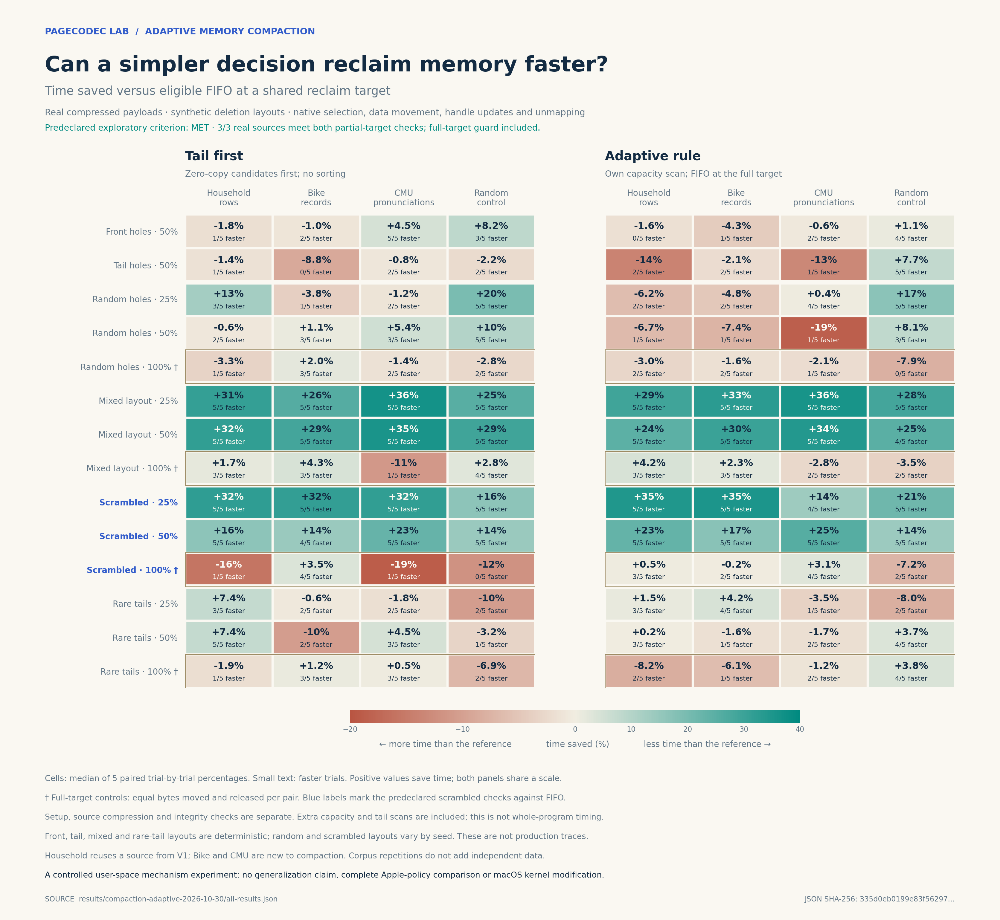

# A cheaper compaction decision

The [first native compaction experiment](COMPACTION.md) found that sorting by
recoverable space versus copied bytes helped some mixed layouts, but often lost
when all segments had to be compacted. The strongest wins came from selecting
segments whose trailing pages could be released without moving live records.

This follow-up tests two simpler decisions in a **user-space arena** with real
copies and page unmapping. It is not a modified macOS kernel or an assessment of
Apple's full production scheduler or compressor.

## Results

The predeclared exploratory criterion **passed** on all three real inputs.
The table shows median paired phase time saved by adaptive versus FIFO; negative
values indicate a slowdown. Each cell contains five paired trials.

| Real input, seeded mixed layout | 25% reclaim | 50% reclaim | 100% reclaim |
|---|---:|---:|---:|
| Household rows | 34.51% | 23.14% | 0.51% |
| Bike records | 35.02% | 17.17% | −0.24% |
| CMU pronunciations | 13.72% | 25.33% | 3.10% |

The result is not universal. On the dictionary with randomly placed holes and a
50% quota, adaptive took 18.54% more phase time than FIFO. On seeded mixed
dictionary data at 25%, adaptive was about 15% slower than the earlier
efficiency-ranking rule even though it beat FIFO. The full chart includes all
56 scenarios and both gains and regressions.



[Compare against efficiency ranking](../assets/compaction-adaptive-versus-efficiency.png) ·
[Raw results and summary](../results/compaction-adaptive-2026-10-30/) ·
[Independent post-run input audit](../results/compaction-adaptive-2026-10-30/input-audit.json).

The post-run audit separately rehashed the source and packed files, checked
every decompressed page against the original input, and independently recomputed
the recorded input fingerprints. The summary generator itself does not perform
that audit, which explains the narrower wording in its limitations field.

## Reproduce

From the repository root, prepare the previously published inputs, then run into
a new, empty measurement directory. Preparing inputs downloads the source data.

```sh
python3 scripts/prepare_household.py
python3 scripts/prepare_end_to_end.py
python3 scripts/prepare_operations.py
python3 scripts/prepare_initial.py
python3 scripts/prepare_compaction_adaptive.py
python3 scripts/run_compaction_adaptive.py --output measurements/my-adaptive-run
python3 scripts/audit_compaction_adaptive.py --results measurements/my-adaptive-run
python3 scripts/summarize_compaction_adaptive.py --results measurements/my-adaptive-run
```

The generated manifest records the local zlib version and packed hashes;
compressed bytes may differ across zlib versions. A fresh run on another
machine is a new observation, not a reproduction of the original timing.

## Policies

- **FIFO:** scan eligible segments in queue order.
- **Benefit:** sort eligible segments by recoverable bytes.
- **Efficiency:** sort by recoverable bytes divided by predicted moved bytes
  plus one physical page.
- **Tail first:** scan for segments reclaimable without moving live records,
  process them first, then use FIFO for any remaining quota. Both scans and the
  metadata checks are charged to the measured phase.
- **Adaptive:** independently recompute the total reclaimable capacity inside
  its measured phase. If the target requires all of it, use FIFO directly;
  otherwise use tail first and then FIFO. It does not receive the experiment's
  separate quota-scan result for free.
- **None:** one no-compaction control per scenario, not treated as a competitor
  for a positive reclaim target.

The policies share the same packing code and one-page eligibility guard. No
neural network or learned model is involved. A learned approach would need to
beat these simpler references after paying its training and observation costs.

## Inputs and scenarios

The three real inputs are household measurements in row order, Bike Sharing
source text, and the CMU pronunciation dictionary. Bike and the dictionary are
new to the compaction experiment but were used elsewhere in this repository;
the household row layout is a different representation of the same household
source used previously. Random bytes are a synthetic incompressible control.
Each input is split into 16 KiB pages, compressed with zlib level 1 and verified
against the original bytes. Small corpora are repeated to create an arena of
about 48 MiB of compressed payload. Copies are not independent real data.

Deletion layouts are synthetic: front holes, trailing holes, randomized holes,
the earlier deterministic mixed layout, a new seeded per-segment mixed layout
(`scrambled`), and an adverse case with a trailing-hole segment once every 16
segments (`rare_tail`). The last case is periodic, not a production trace.
The target is 25%, 50% or 100% of the actually reclaimable pages where relevant.
All methods receive the same source, seed, constructed arena and quota in a
paired trial. Actual release and any quota overshoot are retained.

The preregistered exploratory success rule requires an **adaptive** median
paired time reduction of at least 10% for both scrambled partial quotas on at
least two of the same three real inputs, with no median slowdown over 10% on any
real input at scrambled 100%. This is a screening rule, not a statistical proof
that the result generalizes to production.

## Measurement and verification

The primary phase includes selection, metadata scanning, real `memmove`, handle
updates and `munmap`; the common construction, cache conditioning, quota setup
and correctness checks are reported separately. Five paired rounds use
different seeds and shuffled order in fresh processes. Random and scrambled
layouts vary with the seed; front, tail, mixed and rare-tail layouts repeat the
same pattern. The pilot and final run have the same trial-zero seed, but no
policy or threshold was changed after inspecting the pilot.

Every process verifies its live-object checksum before and after compaction.
Paired runs must start from matching handles, byte counts and quota. For every
full-reclaim pair, the runner requires the same released bytes, moved bytes and
number of moved records across all five competing policies. Independent small
fixtures and ASan/UBSan test the implementation. A separate post-run audit can
rehash the sources and packed inputs, check every decoded page against the
original, and verify recorded input fingerprints.

Reported medians and ranges are observations from a shared Mac desktop, not
confidence intervals, production workload results, or proof that macOS itself
is faster. Resident-memory measurements corroborate unmapping; they are not
assumed identical to it.
