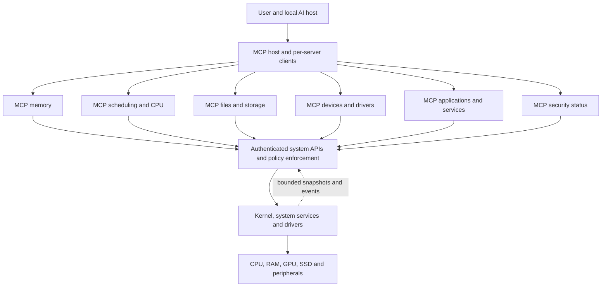

# An AI-accessible system through MCP

This is a proposal for the future operating-system architecture, not an
implemented MCP service, a description of current macOS, or evidence that an
AI can inspect or control every component of this Mac. The goal is to make each
major subsystem observable and controllable through clearly defined interfaces,
subject to the capabilities and permissions actually supplied by that subsystem.

## Architecture

The **data plane** handles instructions, page faults, scheduling, device
interrupts, file I/O and buffer transfers. The **control plane** exposes
bounded observations and supported actions to the AI. MCP servers are
user-space adapters to system interfaces: one per domain is a logical grouping,
not a requirement to spawn a process for every device, page or crossing. The
kernel retains authority over safety and protection. The system continues to
operate if an AI or MCP server fails or is unavailable.

The MCP [2026-07-28 specification](https://modelcontextprotocol.io/specification/2026-07-28)
describes a host, clients and servers communicating with JSON-RPC. Servers
can expose [resources](https://modelcontextprotocol.io/specification/2026-07-28/server/resources)
and [tools](https://modelcontextprotocol.io/specification/2026-07-28/server/tools);
resource subscriptions are optional. This proposal chooses a specification
version for design discussion; actual implementations need version
discovery and compatibility tests, including older negotiated clients. The
2026 revision makes requests self-contained rather than relying on a protocol
session; implementation details differ from older versions. MCP is an interface, not a mechanism
that automatically reveals private firmware or grants device privileges.

## Proposed domain interfaces

The entries below are **examples to design**, not currently available tools.
An operation exists only when implemented by the relevant platform and
authorized for the caller. Reports carry a timestamp, source, scope, units and
availability; missing data is represented as unknown, not zero.

| Domain | Readable resources or observations | Potential controlled operations | Important boundary |
|---|---|---|---|
| Boot and platform | Boot status, kernel identity, hardware inventory and support matrix. | Inspect supported next-boot settings; prepare a change where supported. | Firmware state and secure-boot controls may be unavailable; boot changes need a recovery path. |
| Memory | Aggregate resident, compressed, free and swap statistics; per-workload usage where permitted. | Set an authorized, bounded reclaim policy or diagnostic capture. | No blanket read access to application memory, credentials or other users' data. Wired and DMA-active pages remain protected. |
| CPU and scheduling | Core/cluster topology, runnable and waiting aggregates, workload-level latency. | Set an allowed QoS preference or time-limited budget. | Kernel preserves affinity, fairness, priority and progress; no model call in the scheduling fast path. |
| Files and storage | Storage space, I/O pressure, filesystem health and authorized metadata. | Schedule or cancel allowed I/O, manage explicit cache policy or initiate an approved maintenance action. | File contents, durable writes and destructive operations require separate rights and semantics. |
| GPU and display | Available devices, queue/usage summaries, resource capabilities. | Select supported policy hints, request diagnostics or manage an authorized workload. | A generic MCP does not create an internal GPU driver, private telemetry or a right to inspect other apps' buffers. |
| Drivers and devices | Device inventory, driver state, errors and capabilities. | Restart an eligible isolated service, request a supported reset or change a bounded setting. | DMA, device ownership, dependent applications and device-specific recovery must be respected. |
| Applications and IPC | Process/service health and authorized workload metadata. | Start, stop or configure a service within its delegated scope. | Process identity and permissions must be checked at execution, not inferred from a name alone. |
| Workflows and shared objects | Authorized flow topology, buffer ownership, format, lifetime and completion state. | Start or stop an authorized pipeline, select permitted shared/copy paths or release an eligible reference. | An object identifier does not itself convey access rights; shared bytes, DMA and fences remain protected. |
| Network, power and thermal | Interface state, link and energy/thermal aggregates when exposed. | Adjust an authorized policy or request a diagnostic. | Decisions can affect connectivity, thermals and other workloads; platform control may be private. |
| Security and audit | Policy status, authorization decisions and appropriately redacted audit records. | Request or revoke a narrowly scoped grant; inspect configuration. | The interface cannot grant itself higher privileges or expose secrets merely because an AI asks. |

## Access, isolation and reliability

- **Separate identity and authority.** Authenticate the host and service;
  validate caller identity, target object and scope at the system API, not
  just in an MCP tool's description. An AI-generated request is untrusted input.
  Local stdio subprocesses and remote HTTP deployments have different trust
  boundaries; HTTP/OAuth mechanisms do not automatically authenticate stdio.
- **User-defined control.** Offer read-only, scoped automatic and sensitive
  action modes. The owner can delegate an explicit bounded scope, revoke it,
  and review sensitive or destructive actions. An operation outside the grant
  requires authorization; the kernel still enforces invariants. This is a design
  choice, not a claim that MCP itself automatically enforces the policy.
- **Do not expose secrets by default.** Aggregated counters and narrowly scoped
  resources are preferred to raw memory, file contents, tokens or unrelated
  user data. Cross-subsystem joins must preserve the original access restrictions.
- **Bound costs and staleness.** Include collection overhead, timestamps,
  rates, quotas, cancellation and expiry. Samples can be stale or dropped;
  optional notifications are not a complete, lossless system trace.
- **Protect against hostile content.** Files, device names, logs and tool
  outputs may contain instructions aimed at the model. Treat them as data;
  authorization decisions must be enforced by deterministic code and not by
  trusting such text or tool annotations.
- **Fail safely.** Every action declares preconditions, expected impact,
  timeout and result. Use a deterministic fallback if AI, host, adapters or
  telemetry fail. Rollback is offered only when the subsystem actually supports
  it; partial failure, concurrent changes and irreversible writes must be
  reported honestly. Audit records must avoid unnecessary sensitive data.

See the official MCP [security guidance](https://modelcontextprotocol.io/docs/2025-11-25/tutorials/security/security_best_practices)
for protocol-related risks. These controls are architectural requirements we
propose; they are not proof of security in an unimplemented system.

## Example: diagnose memory pressure across domains

1. The user grants a scoped diagnostic permission. The host reads memory,
   scheduler and storage summaries using their respective MCP interfaces.
2. Each response describes its timestamp and coverage. The host correlates
   pressure, CPU backlog and I/O activity, preserving uncertainty and avoiding
   a claim that correlation proves causation.
3. The AI proposes an eligible bounded adjustment, with duration and expected
   effect; or reports that existing information is insufficient. A sensitive
   operation is reviewed according to the user's grant.
4. The system API validates the current state, authorization, limits and
   generation before applying anything. A stale recommendation is rejected.
5. The host observes subsequent aggregate outcomes, records the decision and
   ends the temporary setting or uses a supported recovery action. Results
   include failure and uncertainty; no benefit is assumed in advance.

This example does not call an LLM for each memory access, expose arbitrary page
contents or bypass platform protections. It is a possible interaction flow,
not an implemented tool or measured improvement.

## Neural decision models: Jev as the design reference

For this design, the project owner asks us to **assume Jev will be useful and
reliable** and to treat it as the reference decision advisor. This is an
explicit design assumption, not a result established by our experiments. The
architecture can also accommodate small local neural predictors. The reference is
[Jev from TypeSafe AI](https://docs.typesafe.ai/introduction): the vendor
describes a model that receives a state and typed questions, and returns
structured choices, scores or probabilities. Its [documented API](https://docs.typesafe.ai/api/system-one)
is hosted and requires authentication; we have not verified that Jev can run
locally or that its weights are available. The vendor reports confidence and
calibration properties; these must be independently checked for the system
workloads and data distributions in question.

Possible use: given a permitted, timestamped **aggregate** view of resource
pressure, ask which of several already-valid, time-limited policy profiles to
recommend. A deterministic controller checks authorization, current state,
limits and expiry before execution. The model's recommendation is not itself a
permission, a guarantee of correctness, or a replacement for the actual
scheduler or memory manager. If the model is unavailable, slow, unconfident or
the input is stale, the system keeps a known deterministic fallback.

Jev's hosted API is the proposed option for higher-level, infrequent coordination,
but network delay, availability, fees and disclosure of system metadata are
material trade-offs. A local compact model or simple statistical heuristic could
be compared as alternatives; no live system data should leave the machine
without the user's explicit choice. Interrupt handling, page faults and
individual scheduling decisions cannot depend on a remote model returning in
time. A model claimed to be fast is not automatically fast enough for a kernel
path.

Any future evaluation needs representative held-out workloads, calibration and
error measurement, CPU/memory/energy overhead, end-to-end latency, fairness,
failure behavior and deterministic baselines. Numerical outputs or confidence
scores must not be treated as proven correctness. We have not connected Jev,
trained a model, measured its latency on this Mac, or demonstrated a benefit.
The general idea of adapting a fast policy with slower asynchronous learning has
prior art, for example [Learning-Augmented Heuristics](https://www.usenix.org/conference/osdi26/presentation/xia).
That work does not establish a benefit for Jev or for macOS.

A separate [offline Laya-MLX demonstration](../experiments/local_decision/README.md)
ran on the research Mac using synthetic input. Laya is **not Jev**. It chose an
unhelpful policy in one deliberately simple fictional case; the demonstration
does not establish general accuracy, calibration, or equivalence to Jev. It
does not change system settings or drive the proposed OS.

## Research and implementation gaps

First define the system APIs and ownership model: MCP cannot wrap an operation
that the kernel or a driver does not expose. Next specify schemas, state
versions, identities, capabilities and action semantics for each domain. Only
then build adapters and independent authorization tests, and measure overhead,
latency, fairness and failure behavior. Cross-domain actions need explicit
partial-failure semantics; MCP calls alone do not make a transaction atomic.
The [deep architecture](DEEP_ARCHITECTURE.md) maps the proposed kernel and
device boundaries; the [project comparison](PROJECT_COMPARISON.md) tracks the
underlying hardware and compatibility gaps.
