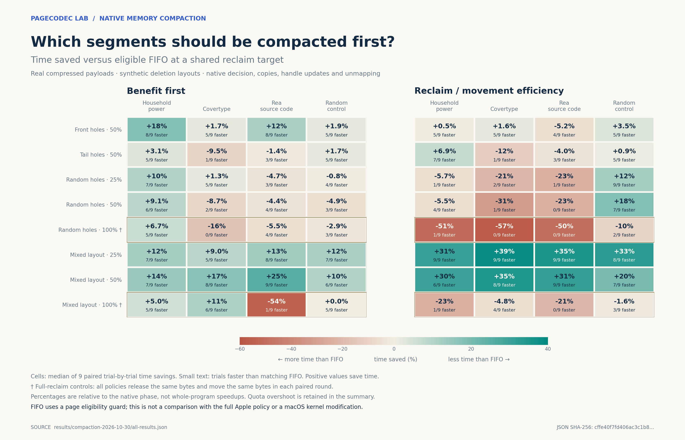
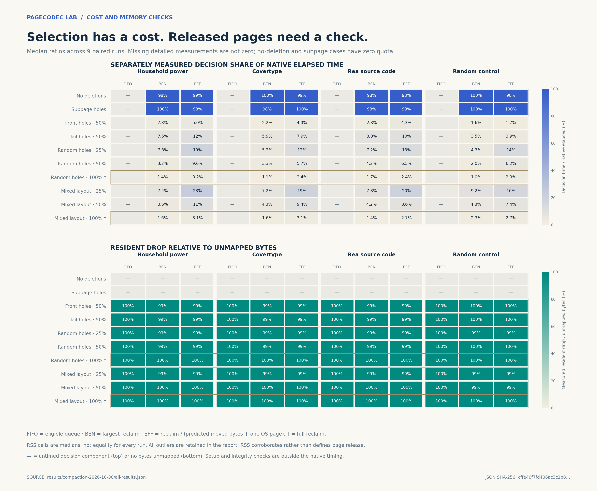

# Native compressed-segment compaction

This experiment tests a low-level memory-management decision: **which compressed
segments should be compacted first when a bounded amount of memory must be
returned to the operating system?** The program performs real memory copies,
updates object handles, and unmaps whole trailing pages. It is an isolated
user-space component, not a patch to macOS or a simulation of the entire kernel.

**Result:** cost-aware ordering helps when it can choose segments that release
pages without moving payloads, but it is not a universally faster policy. On the
three real corpora with the fixed mixed layout and a 25% reclaim quota, it saves
**30.59–38.55% of native phase time** in median paired comparisons and wins all
nine repetitions. On Covertype with random holes and a 100% quota, it instead
takes **57.01% more time**, losing all nine repetitions while doing the same
amount of copying and release as FIFO.



[1,120 raw measurements](../results/compaction-2026-10-30/all-results.json) ·
[Compact process CSV](../results/compaction-2026-10-30/process-samples.csv) ·
[Validated summaries](../results/compaction-2026-10-30/summary.json)

## Why this target

[Local REA and Ghidra inspection](NATIVE_MEMORY.md) located a fragmentation
comparison in the ARM kernel image matching the test machine. The image's
initial threshold is 10%; its current live value was not read. Public sources
for that XNU version show that this global decision is only part of the policy.
Downstream, Apple already skips minor compaction when less than a physical page
is recoverable, copies records only after the first hole, and releases memory
in page units. Ignoring these safeguards would create an artificially weak
reference.

Our reference is therefore named **eligible FIFO with a one-page guard**. It
borrows those mechanisms, but does not reproduce Apple's complete queueing,
locking, scheduling, compression hardware, or swap behavior. Source-level
guards and binary-confirmed observations are distinguished in the linked report.

Each process executes one reclamation episode. It does not model subsequent
allocations, updates, page faults or concurrent readers, and it is not a complete
reusable allocator. User-space `munmap` also has a different cost from XNU's
internal page-depopulation operation.

## What is compared

Every method starts with the same compressed objects, segment layout, deletion
mask and reclaim quota. All methods use the same native compaction routine.

| Method | Segment selection |
|---|---|
| FIFO | First eligible segment in allocation order |
| Benefit | Largest number of whole bytes recoverable first |
| Efficiency | Largest ratio of recoverable bytes to predicted moved bytes plus one page |
| No compaction | Negative control; fails a positive reclaim quota |

The efficiency denominator's extra page is a fixed, disclosed proxy for the
per-segment cost. The number of bytes to move can be calculated from the object
offsets. This is an analytical cost heuristic, **not machine learning**. A learned
model is not justified merely by the availability of AI: it would have to beat
this inexpensive calculation after paying for training and inference.

## Data and workload

The payloads are losslessly compressed 16 KiB pages from household power
measurements, Covertype numeric values, and public REA JavaScript source. A
synthetic random-byte corpus is an incompressible control. Preparation uses
zlib level 1 and verifies every decompressed page against its original bytes.
This codec provides realistic variable-sized objects; codec throughput is not
the subject of the comparison.

Small corpora are repeated to create similarly sized pools of about 96 MiB of
compressed payload. Repetition does not create additional independent data.
The [manifest](../manifests/compaction-v1.json) records original hashes, sizes,
compressed sizes and copy counts.

Deletion layouts are generated, **not captured from production applications**:
front holes, trailing holes, random holes, mixed occupancies, no holes, and
deletions insufficient to release a page. Segments have 64 KiB capacity, matching
the public macOS ARM default; record alignment is this prototype's explicit
16-byte choice. The machine's physical page size determines releasable units.

Each layout has a common target of 50% of its reclaimable pages. Random and mixed
layouts also test 25% and 100%. At 100%, every eligible segment must be processed:
ranking cannot save movement work and may simply add overhead. A partially
fulfilled final segment may overshoot the quota; actual release is reported.

## Measurement boundaries

The primary phase includes policy-specific inspection, predictions, candidate
storage and sorting, real `memmove`, handle updates, and `munmap`. It ends before
post-operation integrity checking. Setup, deletion bookkeeping, the common
calculation of a feasible quota, and checksums are reported separately. The
quota calculation is experimental scaffolding, not a predictor offered for
free to a deployed memory manager. Whole-process elapsed time is also recorded.

The runner uses nine paired rounds with identical layout seeds within each
comparison and shuffled method/scenario order. Each measurement starts a fresh
process. Compiler, code, executable and input hashes are frozen before the run.
The desktop is shared and not an isolated performance host.
The mixed, front and tail layouts are deterministic: their nine repetitions
repeat the same deletion pattern. Only randomized layouts vary with the seed.
These are not nine independent production traces.

An initial 160-process correctness pilot used approximately 24 MiB pools. Its
median positive-work native phase was about 0.39 ms. The final pool target was
increased to 96 MiB to reduce the relative influence of short-duration timing
noise. No selection rule or cost coefficient was tuned from that pilot, and its
single-round samples are not pooled with the final measurements.

A common 64 MiB cache-conditioning buffer is touched after the initial checksum
and before the measured phase. This reduces dependence on which pool segments
the checksum visited last; it does not guarantee a particular hardware cache
state. Its preparation is outside the phase timer, and the buffer remains
allocated during both RSS observations. It is benchmark scaffolding, not
component metadata. Headline timing uses a global phase timer rather than a
timer around every segment. Unmeasured timing subdivisions are reported as
null, not fabricated zero-cost operations.

Memory accounting distinguishes:

- **Pages actually unmapped:** exact arena accounting, in OS page units.
- **Resident-set change:** a process-level observation, potentially affected by
  metadata, allocator behavior and the operating system.
- **Peak RSS:** a process high-water mark, not memory remaining after compaction.
- **Metadata:** additional state needed by the component and its policies.

Surviving object contents must have identical ordered checksums before and after
compaction. Preparation independently verifies lossless decoding. Correctness
fixtures and sanitizer runs precede performance measurements.

## Reproduce

Prepare the existing repository corpora first, as described in
[DATASETS](DATASETS.md), [INITIAL_EXPERIMENTS](INITIAL_EXPERIMENTS.md) and
[OPERATIONS](OPERATIONS.md). Then:

```sh
make test-compaction sanitize-compaction CXX=clang++
python3 scripts/prepare_compaction.py
python3 scripts/run_compaction.py --output measurements/my-compaction-run
python3 scripts/summarize_compaction.py --results measurements/my-compaction-run
# Install figure-only dependencies in your preferred Python environment.
python3 -m pip install -r requirements-figures.txt
python3 scripts/plot_compaction.py --results measurements/my-compaction-run
```

## Results: what worked and what failed

The final run contains 40 source/layout/quota scenarios, nine paired repetitions
of each of the three policies, and one no-compaction control per scenario:
**1,120 fresh processes**. All recorded checksums and quota/accounting invariants
pass. An independent audit also checked every frozen source, executable and
input hash. The five correctness test groups pass optimized builds and
AddressSanitizer/UndefinedBehaviorSanitizer.

| Scenario | Alternative | Median FIFO / alternative time | Median paired time saved | Faster repetitions |
|---|---|---:|---:|---:|
| Household, mixed, 25% | Efficiency | 0.586 / 0.364 ms | **30.59%** | **9/9** |
| Covertype, mixed, 25% | Efficiency | 0.531 / 0.325 ms | **38.55%** | **9/9** |
| REA source, mixed, 25% | Efficiency | 0.458 / 0.294 ms | **35.05%** | **9/9** |
| REA source, mixed, 50% | Benefit | 1.030 / 0.725 ms | **24.96%** | **9/9** |
| REA source, random, 50% | Efficiency | 2.068 / 2.491 ms | **−23.00%** | **0/9** |
| Covertype, random, 100% | Efficiency | 4.176 / 6.562 ms | **−57.01%** | **0/9** |

Time columns are each policy's median; percentage columns are medians of the
nine **paired** values `100 × (1 − alternative/FIFO)`. A percentage therefore
need not equal the ratio of the two displayed medians. Observed ranges and every
other scenario are preserved in the summary; these are not confidence intervals
or cross-machine significance claims.

The strongest positive result has a simple mechanism. In mixed 25% cases,
efficiency chooses segments whose remaining objects are already at the front.
It frees trailing pages with **zero payload movement**, while FIFO moves about
3.45 MB (Covertype), 2.90 MB (REA) or 3.62 MB (household). Both methods meet the
same quota; efficiency releases one additional 16 KiB page on Covertype and REA,
and exactly the same bytes on household. Across all positive-work measurements,
the maximum quota overshoot is one page, at most 0.322% of the requested bytes.

This does **not** establish that the general efficiency score is the best way
to exploit trailing holes. A dedicated, inexpensive tail-first rule has not
been compared, and Apple's immediate compaction paths are not reproduced here.
The result identifies useful work avoidance in this arena, not a missing Apple
optimization or a need for AI.

The failures are equally informative. On REA/random 50%, efficiency reduces
median copied payload spans from 21.94 MB to 16.32 MB but is slower in all nine
repetitions. Its median decision time is about 0.163 ms; that alone does not
explain the entire slowdown. Changes in access order, locality and unmapping
order are possible contributors, not established causes.

At 100% quota, **all 72 paired rounds** verify identical moved and released byte
counts. Efficiency is slower in median in all eight full-reclaim scenarios.
Ranking cannot avoid work there. Its selection cost and changed execution order
have to be paid without the work-reduction benefit available at partial quotas.

## Physical memory observations and outliers



All **864 positive-release observations** show a lower resident set afterward.
The median observed RSS reduction is **99.658%** of the bytes unmapped; 770 of
864 are within ±1%. This corroborates physical recovery, but does not equate RSS
change with exact mapping accounting.

Two observations particularly illustrate that distinction, and are retained:

| Observation (zero-based trial index) | Pages unmapped | Observed RSS decrease | Native elapsed / CPU |
|---|---:|---:|---:|
| Random control, mixed 25%, FIFO, trial 7 | 10.000 MiB | 0.125 MiB | 12.968 / 1.803 ms |
| Household, mixed 50%, benefit, trial 7 | 10.844 MiB | 2.547 MiB | 52.592 / 3.836 ms |

Their cause was not identified. No outlier was removed. The desktop's VM and
swap snapshots are included with the raw results. Neither a global application
speedup, energy improvement nor superiority to Apple's production memory policy
follows from this component test.

The useful next hypothesis is a **cheap conditional selector**: exploit known
zero-copy releases first, and avoid expensive ranking when it cannot save work.
An online model would then have to outperform that stronger reference, with
training, observation and prediction costs included.
