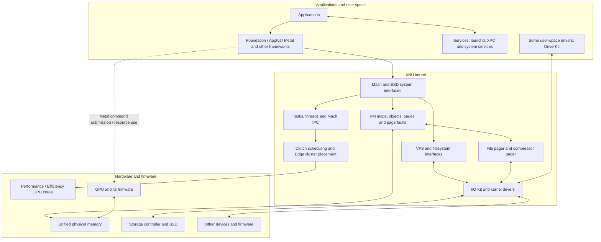
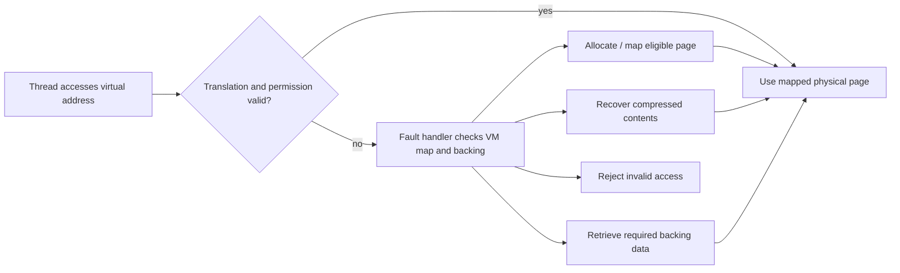
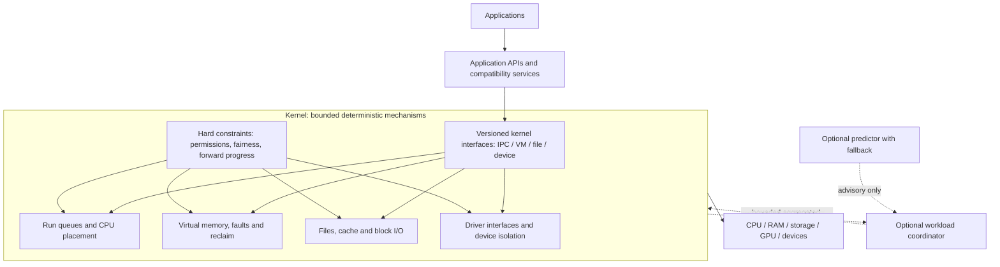
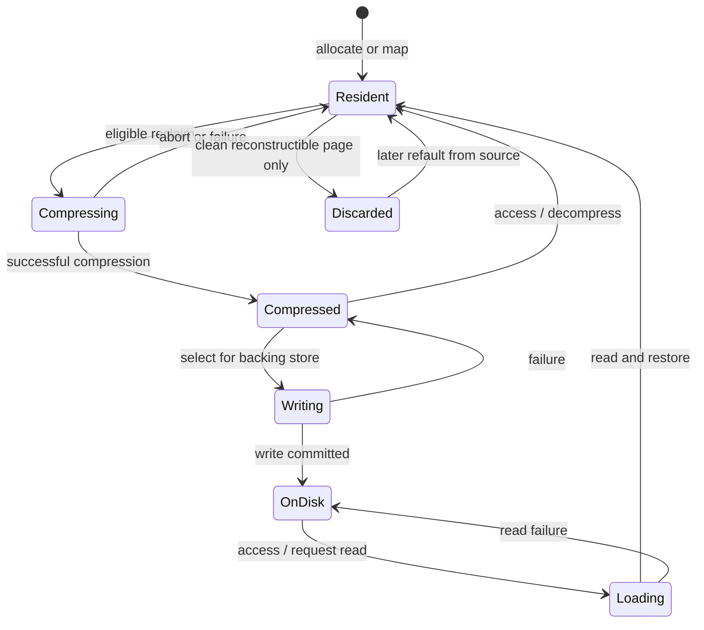

# From macOS mechanisms to a proposed alternative

This is an engineering map, not a description of a completed operating system.
Part I identifies public source and documented behavior. Part II proposes
interfaces and policies for an alternative system. The latter are hypotheses:
they have not been built, proven novel, or shown to outperform macOS.

Evidence labels: **observed** means measured on our research Mac; **source**
means an Apple or project document describes it, not that every running
instruction was verified; **unknown** means private, unobserved, or not yet
matched to the host. Our host reports M4 Pro, macOS 15.1.1, 24 GiB RAM and
`kern.sched=edge`; its Darwin version maps to public XNU tag
[xnu-11215.41.3](https://github.com/apple-oss-distributions/xnu/tree/xnu-11215.41.3).
The tag is a reference, not proof that all running code and controller inputs
are public or identical. The figures below omit some private and firmware paths.

## Starting with the physical machine

A processor executes instructions belonging to a thread. Each process has a
virtual address space: the addresses used by its instructions need not equal
physical RAM addresses. The memory-management unit translates addresses using
page tables; the kernel defines and maintains the mappings. A **page** is a
fixed-size unit of virtual/physical memory management, not necessarily a file
or a hardware memory chip. Our host uses 16 KiB VM pages in the experiments;
page size is a platform property, not a universal constant.

A **page fault** is a hardware exception on an access whose translation or
permissions need attention. Some faults are resolved by the kernel, such as
mapping a page or retrieving content; an invalid access can instead cause an
error. Threads share processors, and the scheduler chooses which runnable
thread gets CPU time. Storage is persistent device-backed space; RAM is working
memory, and compressed memory occupies part of RAM. Device controllers can
perform transfers independently of CPU instruction execution, under mappings
and permissions established by the operating system.

## I. Existing system: components and flows

Arrows describe relationships rather than a literal universal byte path. In
particular, shared data can be accessed through mappings and not every GPU byte
passes through the kernel. APFS and many higher-level services or hardware
controllers are not fully described by public XNU code.

### 1. Boot and trust

Apple describes the chain as Boot ROM, LLB and iBoot, leading to a kernel
collection with firmware and device configuration; its detailed path varies
with boot policy and configuration. The signed system volume is a sealed APFS
snapshot, with user data stored separately. See Apple's
[Apple Silicon boot process](https://support.apple.com/en-ca/guide/security/sec10869885b/web)
and [signed system volume](https://support.apple.com/guide/security/signed-system-volume-security-secd698747c9/web).
Asahi documents [firmware, boot configuration and device descriptions](https://asahilinux.org/docs/platform/introduction/).
This establishes boot boundaries; it does not reveal every firmware behavior.

### 2. A memory access

1. A thread uses a virtual address. Hardware translation may already map it to
   a physical page; on a fault, the kernel checks the process's mapping and
   permissions.
2. XNU's virtual memory uses maps and objects to represent regions and their
   backing. A fault can require a new page, a file-backed page, or recovery
   from compressed or swapped storage. The architecture-specific `pmap` layer
   maintains hardware mappings. See Apple's [VM overview](https://developer.apple.com/library/archive/documentation/Darwin/Conceptual/KernelProgramming/vm/vm.html)
   and the matching [fault handler](https://github.com/apple-oss-distributions/xnu/blob/xnu-11215.41.3/osfmk/vm/vm_fault.c).
3. Under pressure the pageout path selects reclaimable work. Compressed pages
   remain in RAM until they are reclaimed or written to backing storage. The
   [compressor pager](https://github.com/apple-oss-distributions/xnu/blob/xnu-11215.41.3/osfmk/vm/vm_compressor_pager.c),
   [pageout code](https://github.com/apple-oss-distributions/xnu/blob/xnu-11215.41.3/osfmk/vm/vm_pageout.c)
   and [compressor backing store](https://github.com/apple-oss-distributions/xnu/blob/xnu-11215.41.3/osfmk/vm/vm_compressor_backing_store.c)
   show distinct parts of these paths. File-backed pages need not take the same
   route as anonymous pages.
4. Reading a compressed page may require decompression. Segment compaction
   rearranges compressed data to recover space; it is a separate operation.
   Our [bounded kernel-image analysis](NATIVE_MEMORY.md) supports one specific
   compaction gate, not an interpretation of every memory decision.

This chart merges multiple fault subcases for readability: it does not imply
that all page faults allocate memory, read SSD, or decompress a page. Shared,
modified, wired and copy-on-write pages need additional rules.

### 3. A thread becoming runnable

Clutch organizes runnable work by scheduling buckets, thread groups and
threads. Edge adds selection and migration between heterogeneous clusters.
Public source describes per-cluster scheduling latency based on load and
execution-time history; a performance controller can supply preferences and
weights. See Apple's [scheduler design](https://github.com/apple-oss-distributions/xnu/blob/main/doc/scheduler/sched_clutch_edge.md)
and our [version-specific source map](SCHEDULER_RESEARCH.md). The controller's
live state and the full binary behavior have not been reconstructed here.

### 4. File, device and GPU operations

An application requests file operations through system interfaces; VFS,
filesystem and storage drivers cooperate to service them. File caching can
interact with VM, and the SSD is not the same thing as compressed RAM. APFS is
not fully described by XNU's public VFS implementation.

I/O Kit and kernel drivers are distinct from **some** drivers running in user
space through [DriverKit](https://developer.apple.com/documentation/driverkit).
Applications submit GPU work using APIs such as Metal; CPU and GPU may share
resources in unified memory, but synchronization and resource contention still
matter. See Apple's [shared storage mode](https://developer.apple.com/documentation/metal/mtlstoragemode/shared).
DriverKit support does not imply an open general-purpose driver for the internal
Apple GPU. Device firmware and parts of GPU and power management remain opaque.

The historical [I/O Registry description](https://developer.apple.com/library/archive/documentation/DeviceDrivers/Conceptual/IOKitFundamentals/TheRegistry/TheRegistry.html)
explains provider/client relationships and driver matching. Platform controllers
can themselves run firmware and exchange messages with the host; an external
driver is not always just a collection of CPU register writes. See Asahi's
[platform overview](https://asahilinux.org/docs/platform/introduction/).
IOMMU-like device isolation does not mean every device follows one identical
path; the exact mappings and firmware protocols for the target require separate
evidence.

### 5. Coverage and open questions

| Layer | Current evidence | Open work before a full design |
|---|---|---|
| Boot and trust | Apple boot documentation; Asahi platform notes | Exact host policy, firmware boundaries and supported alternative boot path. |
| CPU and scheduling | Host reports Edge and P/E core counts; matching public scheduler source | Live controller inputs, exact binary correspondence, thermal and power interactions. |
| VM and compression | Matching public VM source; bounded kernel-image evidence for one compaction gate | Real page-selection behavior under pressure, private policy, GPU/wired-page interactions. |
| Storage and files | Public VFS source and Apple's APFS/security documentation | APFS internals, storage-controller protocol, caching and durability behavior. |
| GPU and display | Apple Metal API documentation; Asahi hardware research | M4 Pro GPU/firmware protocols, display path and a usable driver. |
| Devices, network, audio | I/O Kit/DriverKit documentation and Asahi platform references | Per-device inventory, transport protocols, DMA isolation, firmware and failure recovery. |
| Security and identity | Boot and signed-volume documentation | Hardware security controllers, signing, credential and service contracts beyond this map. |
| User experience and compatibility | Existing project documentation and public interfaces | Framework coverage, app ABI, graphics APIs, app lifecycle and actual compatibility. |

This is a research inventory, not a guarantee that every private mechanism can
be recovered from public material. Each claim needs its own source, host
observation or explicitly labeled hypothesis.

### 6. Follow one workload across subsystem boundaries

Consider opening a document in an application and displaying it. This is a
simplified causal walk-through, not a trace collected from a specific app:

1. The system starts or activates the application; executable loading establishes
   its process, address space and initial threads. The application can contact
   services through IPC, including XPC; Apple's [XPC documentation](https://developer.apple.com/documentation/XPC)
   describes the service model. Signing, entitlements and actual launch paths
   are application- and configuration-dependent.
2. The application's runnable threads compete for CPU time. The scheduler's
   QoS, grouping, cluster selection and available cores influence when work
   executes. The app can be blocked while awaiting a service or I/O.
3. The document's bytes are obtained through file interfaces; filesystem,
   cache, VM and storage paths may participate. If the data is cached, a disk
   transfer is not necessarily needed; if a mapping faults, the kernel resolves
   the relevant page where allowed.
4. Parsing and preparing the document allocates memory and uses CPU. Under
   pressure, reclaim can create CPU and I/O work; a subsequent access can
   fault, decompress or retrieve backing data. These costs depend on actual
   state and are not predictable from the API name alone.
5. The app prepares graphical work through its framework. With Metal, command
   submission and resource synchronization coordinate CPU and GPU. Their shared
   physical memory does not eliminate synchronization, bandwidth limits or
   all copies. Display involves further system and firmware components.
6. Completion returns control to the app's event handling. End-to-end perceived
   responsiveness includes queueing, CPU work, page faults, service calls,
   device work and display timing. Faster execution of one isolated operation
   does not by itself establish a faster user-visible result.

This example makes the coupling concrete: protecting an interactive thread
from CPU queueing may not help if it is waiting for a page or display; avoiding
memory copies may cost more selection time; caching more file data may increase
pressure elsewhere. We have not traced this scenario on the user's machine.

## II. Proposed system: mechanisms, policy and boundaries

### Mechanism and policy are separate

The kernel remains responsible for access checks, page faults, scheduling,
I/O completion, isolation, and recovery. Its short paths use bounded, simple
rules and retain a safe default if a coordinator is absent, late or wrong.
The optional coordinator works on **aggregated** workload signals and publishes
time-limited hints, not unrestricted commands. This is an architectural
proposal; macOS already has grouped scheduling, policies and statistical
estimates, so this is not a claim that coordination is unprecedented.

The first proposed contract is:

| Interface | Input | Output / boundary |
|---|---|---|
| Workload declaration | A group and bounded latency, throughput or energy preference | A hint, not a guarantee; untrusted workloads cannot raise priority without authorization. |
| Resource snapshot | Aggregated runnable load, reclaim pressure, I/O backlog and contention with timestamps | A bounded snapshot; staleness is explicit and no arbitrary application memory is read. |
| Policy recommendation | Group, expiry and limits for CPU placement, reclaim and I/O | Kernel may clamp or reject hints; access controls, fairness, affinity and device safety always apply. |
| Predictor | Snapshot and recent aggregate history | Advisory estimate plus uncertainty; invalid, slow or missing predictions use deterministic defaults. |
| Feedback | Per-group latency distributions, throughput, resource use, faults and decision costs | Supports evaluation and rollback; metrics and retention need an explicit privacy design. |

Interfaces, budgets and update rates above are design targets, not implemented
APIs. A kernel cannot wait on a user-space predictor during a page fault or an
interrupt. An external recommendation may go stale while a workload changes;
timeouts and a safe default are part of the design, not an afterthought.

For example, a proposed resource snapshot would carry a timestamp, workload
identity and generation, CPU queue estimates, memory pressure and I/O backlog.
Any policy budget derived from it would include an expiry and bounded advice
for migration, reclaim and I/O. The kernel would validate authority, current
state and hard constraints again when applying it. Accounting for shared pages,
thermal signals and devices without suitable metrics remains an open design
problem. Observation rates and retained history must also be limited; no page
contents need to be inspected for this contract.

### Design principle: software locality

The hardware analogy is to keep related work and data close and reduce costly
movement. In software the measurable costs are different: data copies, cache
misses, cross-core migration, address-space transitions, synchronization,
queueing and I/O. This principle does not require merging the whole system into
one privileged component. Apple and other systems already use locality, shared
memory, batching and caching; our open question is which **specific combined
path** can improve on an existing baseline.

For instance, Apple's [IOSurface](https://developer.apple.com/documentation/iosurface)
supports shareable image buffers, and [Metal shared resources](https://developer.apple.com/documentation/metal/mtlstoragemode/shared)
expose CPU/GPU-shared storage. [CPU/GPU synchronization](https://developer.apple.com/documentation/metal/synchronizing-cpu-and-gpu-work)
remains a separate design issue. Our proposal is therefore about possible
orchestration across a wider path, not the invention of shared buffers.

| Proposed direction | Opportunity | Constraint or potential cost |
|---|---|---|
| Keep a workload and its frequently reused data close | Favor a suitable CPU cluster and avoid migrations that destroy useful cache locality. | A busy cluster can delay a thread; pinning can harm fairness, parallelism or energy. The public Edge source already considers load and migration weights. |
| Reuse buffers across stages | Pass a shared buffer or immutable handle instead of copying the same bytes between components. | Ownership, lifetime, permissions and synchronization must be explicit; sharing can cause contention or pin memory. |
| Batch work across a boundary | Combine related requests where possible to reduce fixed transitions and queue operations. | Waiting for a batch can worsen interactive tail latency; a timeout and bounded batch are needed. |
| Place computation near its data | Process data where it already resides or use a suitable CPU/GPU execution path. | Setup, transfers, synchronization, contention and unsupported operations may erase the benefit. |
| Share information across resource policies | Couple CPU placement, page reclaim and I/O decisions using bounded workload-level hints. | Gathering information and coordinating costs CPU and may be stale or conflicting; hard security and fairness constraints remain in the kernel. |
| Avoid duplicate representations | Share or reuse a representation when its ownership and lifetime allow it. | A shared representation can increase coupling, memory retention or failure impact; independently managed consumers may need copies. |

For example, a document pipeline might read into a managed buffer, parse data
in place where safe, and hand immutable regions to rendering without duplicating
each region. The interface must still define who owns the buffer, whether the
producer can mutate it, when consumers have finished, and how it is released.
This is a **candidate design**, not a finding that the current macOS path makes
unnecessary copies. We would first map that real path and its trust boundaries.

One more specific design to explore is a **work-buffer registry**. Each object
would have a bounded length, data format, owner, generation, permitted readers
or writers and a lifetime. Authorized stages could exchange handles rather
than serialize a payload repeatedly. Bounded queues would apply backpressure
when a consumer falls behind. A buffer could be released only after all active
consumers and device operations finish; mapping, synchronization, revocation,
cache coherency and device-specific DMA restrictions must be handled explicitly.
If a consumer cannot safely share the representation, an ordinary copy is a
valid fallback. Such ideas already exist in other systems; we have not built
this registry or determined whether it improves any macOS workload.

A handle must not accidentally expose unrelated bytes that happen to occupy
the same page. DMA mappings and pinned pages need least-privilege scope, quotas
and timely teardown; different devices may use different isolation paths.
Untrusted clients, old APIs or incompatible layouts may require a copy. The
contract must also specify cancellation, fences, device failure and whether a
completed storage write meets the application's requested durability level.

An illustrative target pipeline would be: storage service obtains image bytes;
CPU code decodes or transforms them; an authorized buffer is mapped for the
GPU; the GPU completes its work; the display service consumes the result; the
last owner releases it. A format conversion may still require a new buffer,
and the GPU and display need synchronization. The engineering comparison is
copies and locality saved **versus** mapping, fences, queue delay, retained
memory and isolation costs. This sequence is illustrative; no actual macOS
image pipeline was traced for this document.

A falsifiable design question is whether a declared pipeline contract can
choose among **shared reference**, **isolated copy** and **in-place processing**
at a pipeline boundary, using size, permissions, format, synchronization cost
and available memory. Legacy or uncooperative consumers can use the ordinary
copy path. Selection itself consumes time and memory, so it should not require
a model call for every access. Existing equivalent mechanisms must be researched
before claiming novelty, and all three choices need end-to-end comparison.

### Multiple intersecting flows

A complementary sketch is a layered system with many concurrent flows rather
than one compulsory route through every layer. Small, isolated services could
act as meeting points when flows refer to the same authorized object or event.
For example, an image decoder and a renderer could receive permitted references
to the same image buffer, with an explicit ready/completion signal. A reference
identifies an object; similar-looking data or a common filename is not enough
to assume the objects are interchangeable or their owners consent to sharing.

Each meeting point would declare the format and version, data ownership,
permissions, lifetime, synchronization and failure behavior. A bounded queue
and backpressure would prevent a slow consumer from accumulating unlimited
work; cancellation and failure would release references safely. If sharing is
not safe or available, the path uses an isolated copy. Some flows have no
intersection and should not be forced through an extra broker. Services,
message passing and shared buffers already exist, so the research question is
whether a particular design of these intersections improves the complete
workload after accounting for transitions, coordination, memory and isolation.
This sketch has not been implemented or compared with macOS.

Reducing an IPC boundary may save transitions while removing fault isolation;
shared memory may save bytes copied while increasing synchronization or memory
retention. A proposed path therefore needs both a resource-accounting model and
defined failure containment. The objective is an end-to-end improvement under
explicit constraints, not simply fewer boxes or fewer arrows on a diagram.

### Proposed page lifecycle

This state machine is **our design sketch**, not a claim that XNU uses these
exact state names or transitions. A record must track backing identity,
references, protection and whether the contents have changed. Shared, wired,
device-visible and in-flight pages are subject to eligibility constraints.

The real design must specify concurrency: two faults for the same page cannot
publish inconsistent copies; a write racing with reclaim cannot silently lose
new data; shared mappings and copy-on-write must retain correct references; a
DMA-active or pinned page cannot be reclaimed until the device contract allows
it. Failed compression, reads and writes need recoverable, explicit outcomes.
Durability is a filesystem and device contract, not merely completion of a
memory copy. No implementation of this lifecycle exists in this repository.

### Compatibility is several contracts

Supporting a Mac application would require separate decisions about Mach-O
loading and CPU architecture, system calls and Mach IPC, process and service
lifecycle, frameworks, graphics, signing and security behavior, and file
formats. Matching a kernel interface alone does not make a graphical app run.
Darling and ravynOS illustrate different approaches and incomplete coverage;
see the [project evidence map](PROJECT_COMPARISON.md). We do not yet have a
compatibility implementation or list of supported applications.

### Example: an interactive application under pressure

An app requests responsive work while a background job consumes CPU and
memory. A coordinator could observe pressure and runnable backlog for the two
groups, then suggest short-lived bounds: reserve latency-sensitive capacity,
limit optional background reclaim or I/O, and keep a minimum progress guarantee
for the background group. The kernel decides whether each hint is valid.
This is a scenario to reason about, **not** observed behavior or a promise that
the proposed policy is faster. Restricting reclaim can increase memory pressure;
moving a task can lose cache locality; protecting responsiveness can lower
throughput or increase energy. These effects must be considered together.

### Drivers and practical constraints

The architecture needs device discovery, interrupt handling, DMA mappings and
isolation, reset and error recovery, a storage path, display and input, then
accelerated graphics, networking and power management. Some drivers might be
adapted; others must be developed from hardware evidence. The
[project comparison](PROJECT_COMPARISON.md) records the available upstream
work, M4 Pro gaps, license considerations and a preliminary dependency graph.
We have not built or validated an M4 Pro driver.

### What would establish a genuine improvement?

The system must first boot on its declared target with reliable devices, then
support its stated application and data contracts. Comparisons must count
end-to-end latency (including tail latency), throughput, energy, memory,
fairness, failures and policy overhead under representative workloads. The
baseline must be an actual, specified system and configuration. A VM or a
user-space prototype is useful for correctness and design, but by itself
cannot prove faster hardware drivers or a superior macOS replacement.
