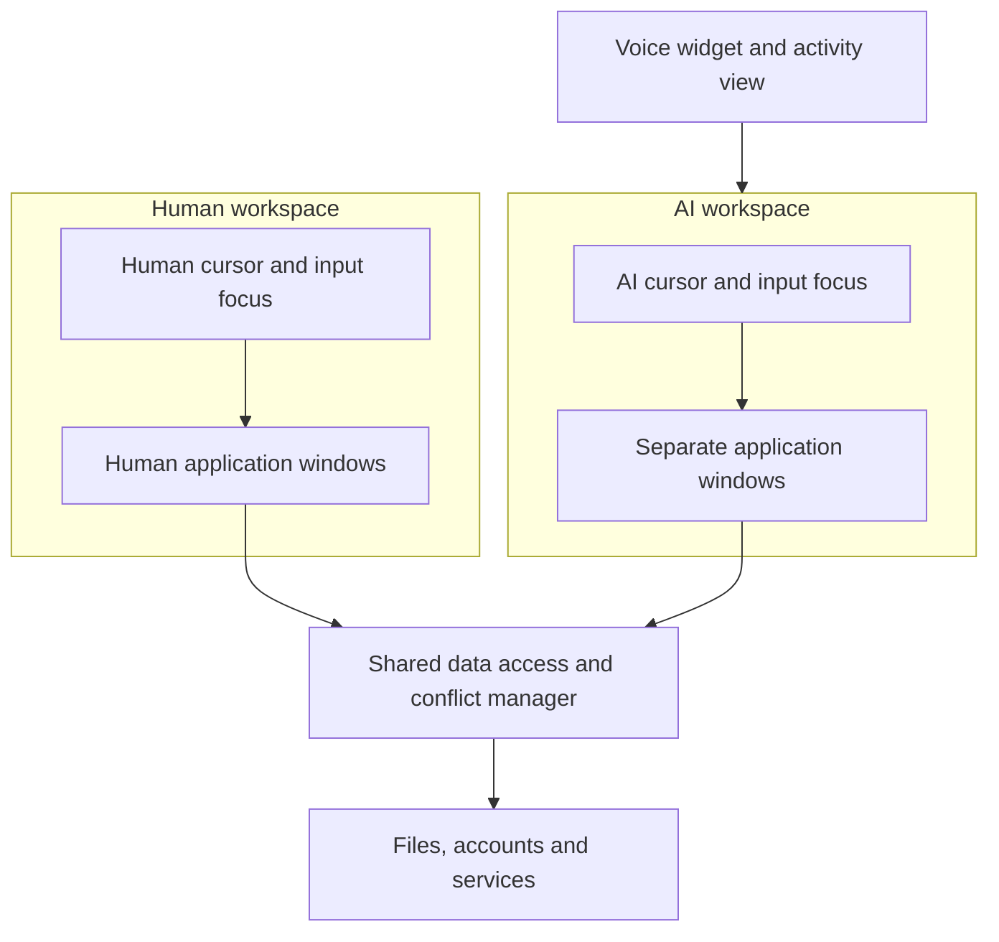

# Two workspaces: one for the person, one for the AI

This is a design proposal for the future OS. It has not been implemented, and
two windows or drawn cursors on today's macOS do not by themselves establish
independent application state or independent input focus.

## What the user sees

The person has a normal workspace with their own windows, pointer and focus.
The assistant has a distinct workspace with its own windows, pointer, focus
and tasks. Its cursor and activity are visibly distinguishable. A floating
[voice widget](VOICE_ASSISTANT.md) can show progress and reopen the relevant
conversation or the assistant workspace. The user can see what the assistant
is doing, pause or stop it, and inspect results.

Separate workspaces prevent one actor's pointer and focus from automatically
stealing the other's. They do **not** imply separate files, databases, remote
accounts, application profiles, clipboard state or device resources. Two
windows may also belong to the same application process. Independent views,
processes and data copies are three different properties.

## Window and input model

The compositor presents distinct workspaces and draws the two cursors. An input
router tags events by actor, target and authorization, with per-workspace
pointer capture and focus where the application supports them. An AI action
should target an authorized semantic UI object when available; coordinates
alone do not reliably identify a control. The widget can reveal the target and
current action without moving the human pointer.

The window manager requests a separate window or application instance for the
assistant when the application supports it. Some applications enforce a single
instance, share a process or expose one global focus; an adapter may have to
use separate sessions, serialize actions or report that full parallelism is not
available. Keyboard focus, caret, menus, modal dialogs, drag-and-drop and the
clipboard need explicit per-workspace or shared-resource semantics. There is no
assumption that every existing Mac application supports two independent input
streams.

## Data, conflicts and user control

The two workspaces can share selected data without copying it all. Each access
retains the actor's authorization. For read-only work, both actors can often
inspect the same object concurrently. For edits, an implementation could use
one of several modes:

| Mode | Behavior | Trade-off |
|---|---|---|
| Shared live state | Both work on the same underlying object. | Needs coordination, version checks and clear conflict reporting. |
| Working copy or snapshot | The AI works on an isolated version, then proposes or applies a merge under the user's delegated authority. | Copying, storage and merge cost; remote side effects may not be reversible. |
| Exclusive operation | One actor temporarily reserves a conflicting resource. | Simple semantics but can delay the other actor. |

An arbiter should detect incompatible edits or stale object versions; it must
not silently overwrite another actor's work. Permission to view a document is
not automatically permission to change it or act on an external account.
Transactions, rollback and snapshots only apply where the underlying service
actually provides them; sent messages and external changes can be irreversible.
The user controls the delegated scope and can inspect activity and stop future
actions. The design does not require asking for confirmation for every routine
action already covered by an explicit delegation.

## Connection to the system and AI

The AI workspace is a UI surface and execution context. The assistant can use
authorized semantic interfaces and the [MCP control plane](AI_CONTROL_PLANE.md)
when available; the separate cursor represents UI actions rather than replacing
those interfaces. The kernel and services still enforce permissions, process
isolation and resource limits. The assistant's workspace and voice session
continue only while configured to do so, and their failure does not stop the
human workspace.

On current macOS, [accessibility actions](https://developer.apple.com/documentation/applicationservices/1462091-axuielementperformaction)
can target exposed UI elements with appropriate authorization, but may be
unsupported or fail. [Core Graphics events](https://developer.apple.com/documentation/coregraphics/cgevent)
and an overlay do not by themselves prove independent system-wide focus or
isolated application state. Any macOS prototype must separately establish what
is possible on the target version. This document proposes capabilities for a
new system rather than claiming they exist now.
