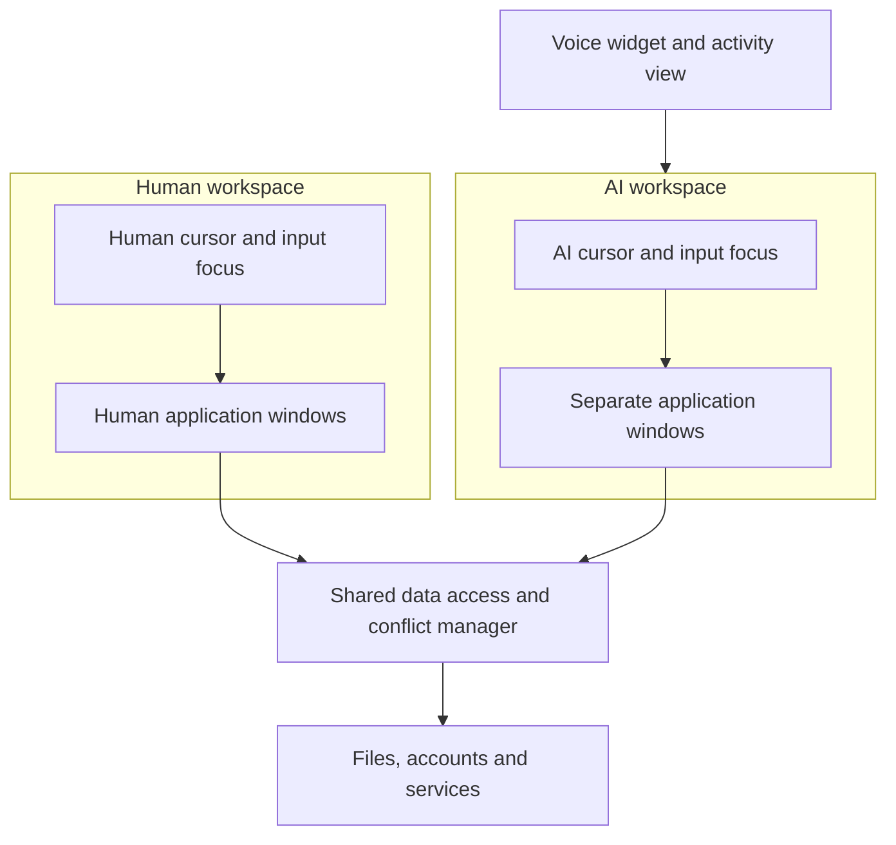
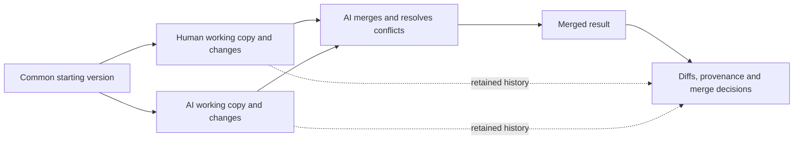

# Two workspaces: one for the person, one for the AI

This is a design proposal for the future OS. It has not been implemented, and
two windows or drawn cursors on today's macOS do not by themselves establish
independent application state or independent input focus.

## What the user sees

The person has a normal workspace with their own windows, pointer and focus.
The assistant has a distinct workspace with its own windows, pointer, focus
and tasks. Its cursor and activity are visibly distinguishable. A floating
[voice widget](VOICE_ASSISTANT.md) can show progress and reopen the relevant
conversation or the assistant workspace. The user can see what the assistant
is doing, pause or stop it, and inspect results.

The owner also wants a **remote human participant** to have a third workspace
and pointer. The intended design generalizes to multiple named actor sessions,
not a permanent limit of exactly two. The machine owner determines the remote
participant's access scope and can revoke it. Identity, transport and grants
must be enforced by the system; a visible third cursor alone does not establish
remote access or isolation. Remote input and a third workspace are not yet
implemented in the current two-pointer prototype.

The target is an extensible number of participants; the owner's example of
1,000 agents illustrates flexibility, not a fixed capacity requirement. Each pointer needs a
stable actor/session identity, coordinates, target workspace, focus, permissions
and lifecycle. Pointer creation and retirement, batching, event backpressure and
rendering costs must be measured as the number of active actors grows. The UI
may offer user-controlled filtering or grouping for readability, without
silently collapsing distinct actors into one. Independent pointers do not imply
that every legacy application supports 1,000 separate simultaneous keyboard
focuses, nor that 1,000 application instances fit into available memory.

The present two-pointer demonstration is the first functional step; it does
not establish a supported participant count or performance. A scalable actor
registry, revocable permissions, multi-party conflict handling and realistic
VM workloads are future implementation and measurement work.

Separate workspaces prevent one actor's pointer and focus from automatically
stealing the other's. They do **not** imply separate files, databases, remote
accounts, application profiles, clipboard state or device resources. Two
windows may also belong to the same application process. Independent views,
processes and data copies are three different properties.

## Window and input model

The compositor presents distinct workspaces and draws the two cursors. An input
router tags events by actor, target and authorization, with per-workspace
pointer capture and focus where the application supports them. An AI action
should target an authorized semantic UI object when available; coordinates
alone do not reliably identify a control. The widget can reveal the target and
current action without moving the human pointer.

The window manager requests a separate window or application instance for the
assistant when the application supports it. Some applications enforce a single
instance, share a process or expose one global focus; an adapter may have to
use separate sessions, serialize actions or report that full parallelism is not
available. Keyboard focus, caret, menus, modal dialogs, drag-and-drop and the
clipboard need explicit per-workspace or shared-resource semantics. There is no
assumption that every existing Mac application supports two independent input
streams.

## Data, conflicts and user control

The intended default for editable work is **separate working copies** derived
from a common version: the person and AI edit independently and concurrently.
The AI then automatically merges both sets of changes, including deciding how
to resolve conflicts within its delegated authority. A result view identifies
human changes, AI changes, combined resolutions and uncertain attribution.
This is a proposed behavior, not an implemented merge engine. Each access
retains the actor's authorization; read-only data can be shared where allowed.

The mechanism would record a stable base revision, two change sets, actor
identity and the resulting merged revision. A three-way comparison like
[Git's merge model](https://git-scm.com/docs/git-merge) is a useful reference
for text; format-aware adapters are needed for other document types. After a
deterministic merge of non-overlapping edits, the AI could select, combine or
rewrite conflicting changes. The result view should disclose when the AI
resolved a conflict and show the source changes and resulting decision, without
claiming that its resolution is necessarily correct. If a merge cannot be
performed or its input changes mid-operation, the system retains both branches
and reports the failure rather than fabricating a completed result.

Provenance is recorded when changes are made, not guessed solely from the final
text. An AI-written conflict resolution that combines both sides must be marked
as such; imported or untracked edits may have unknown origin. Depending on the
format, attribution may be at file, object, paragraph or character level. The
user can inspect the diff, the resolution and prior versions; the design does
not require interrupting the user for each conflict.

For a collaboration-aware document, the system could track actor, operation,
document version and causal history, then exchange updates and merge them.
[Automerge](https://automerge.org/docs/hello/) and [Yjs](https://docs.yjs.dev/)
are existing examples of shared data structures designed for concurrent updates.
They are prior art, not components we have integrated. Convergence does not
guarantee the merged result reflects human intent: conflicting values or edits
with incompatible meaning need explicit treatment. Automerge documents cases
where [concurrent updates to the same property conflict](https://automerge.org/docs/reference/documents/conflicts/).

The suitable strategy depends on the resource; an implementation could use
one of several modes:

| Mode | Behavior | Trade-off |
|---|---|---|
| Shared live state | Both work on the same underlying object. | Needs coordination, version checks and clear conflict reporting. |
| Separate working copies (intended default) | Human and AI work independently; the AI merges both changes under delegated authority and reports provenance. | Copying, storage, conflict resolution and validation cost; remote side effects may not be reversible. |
| Exclusive operation | One actor temporarily reserves a conflicting resource. | Simple semantics but can delay the other actor. |

The merge service detects incompatible edits or stale object versions and keeps
both prior histories so the AI's resolution remains inspectable. Permission to view a document is
not automatically permission to change it or act on an external account.
Transactions, rollback and snapshots only apply where the underlying service
actually provides them; sent messages and external changes can be irreversible.
The user controls the delegated scope and can inspect activity and stop future
actions. The design does not require asking for confirmation for every routine
action already covered by an explicit delegation.

## Connection to the system and AI

The AI workspace is a UI surface and execution context. The assistant can use
authorized semantic interfaces and the [MCP control plane](AI_CONTROL_PLANE.md)
when available; the separate cursor represents UI actions rather than replacing
those interfaces. The kernel and services still enforce permissions, process
isolation and resource limits. The assistant's workspace and voice session
continue only while configured to do so, and their failure does not stop the
human workspace.

On current macOS, [accessibility actions](https://developer.apple.com/documentation/applicationservices/1462091-axuielementperformaction)
can target exposed UI elements with appropriate authorization, but may be
unsupported or fail. [Core Graphics events](https://developer.apple.com/documentation/coregraphics/cgevent)
and an overlay do not by themselves prove independent system-wide focus or
isolated application state. Any macOS prototype must separately establish what
is possible on the target version. This document proposes capabilities for a
new system rather than claiming they exist now.
