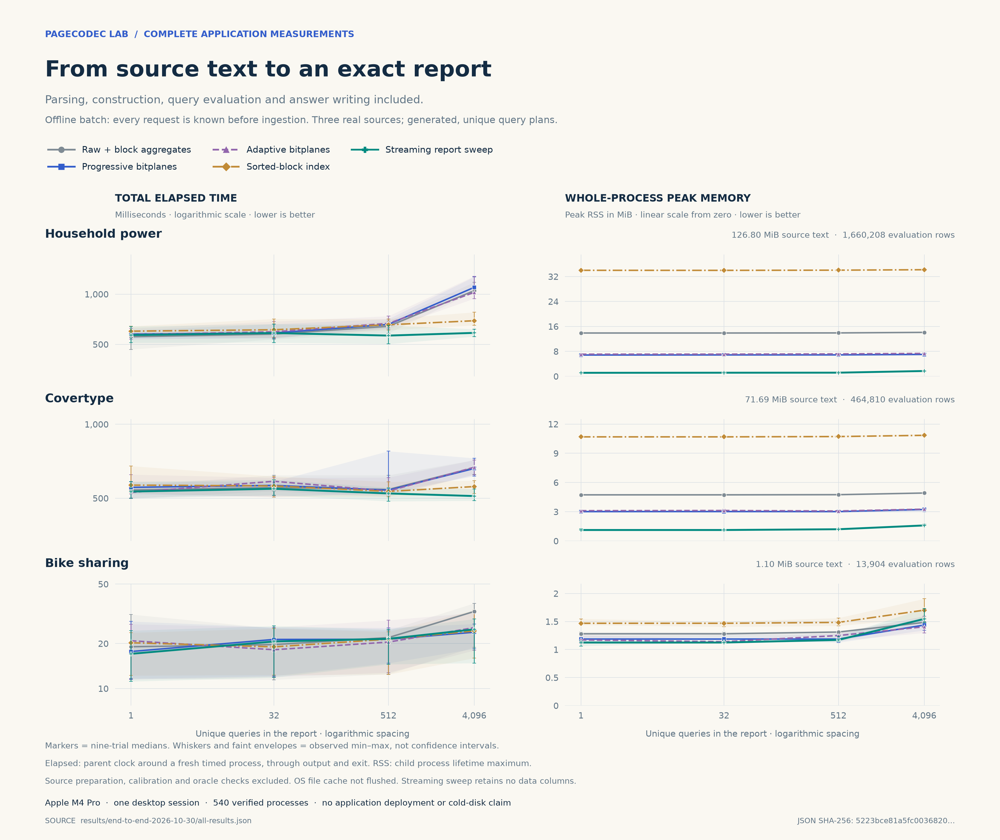

# A complete report application: time and peak memory

The earlier bitplane experiment showed promising warm query speed and compact
representations, while construction increased peak memory. This follow-up asks
a stricter question: **can a complete application produce the same exact report
faster and with a lower peak resident set, including construction?**

The application reads original source text and a supplied query plan, then writes
every requested answer to JSON. The comparison includes five ways to accomplish
that task. It is a functional reporting prototype using real data and generated
plans, not a deployed product or a replay of production traffic.

## Outcome: the full-task win comes from a streaming report

The completed run contains **540 verified fresh-process measurements**, covering
five methods, three independent real sources and four report sizes. The streaming
endpoint sweep meets the predeclared two-source rule. Neither bitplane variant
meets it. This is a positive result for avoiding materialization when the entire
report is known in advance; it does not confirm that the compressed query engine
is the best complete-application design.

At **4096 unique questions**, including source reading, parsing, construction,
queries, report writing, process launch and exit:

| Source | Raw elapsed → sweep elapsed | Raw peak RSS → sweep peak RSS | Elapsed reduction | Peak RSS reduction |
|---|---:|---:|---:|---:|
| Household | 1048.95 → **585.73 ms** | 14.094 → **1.703 MiB** | **44.16%** | **87.92%** |
| Covertype | 665.29 → **510.35 ms** | 4.922 → **1.594 MiB** | **23.29%** | **67.62%** |
| Bike | 32.80 → 24.89 ms | 1.484 → 1.547 MiB | 24.10% | **−4.21%: more RSS** |

These are medians of nine fresh processes. On both larger sources, the sweep
also beats raw by at least 10% in **both** metrics in all nine paired rounds.
The reduction is measured whole-process peak RSS, not a derived capacity
estimate. On Bike, query-plan state outweighs the small input-storage saving;
it fails the memory criterion. Launch/wrapper overhead is a large fraction of
the small Bike timings, so its apparent speed gains deserve less weight.



The full five-way comparison at the largest report size is:

| Source | Method | External elapsed, median ms | Whole-process peak RSS, median MiB |
|---|---|---:|---:|
| Household | Raw NEON + aggregates | 1048.95 | 14.094 |
| Household | Progressive bitplanes | 1098.35 | 7.016 |
| Household | Adaptive bitplanes | 1024.49 | 7.344 |
| Household | Sorted blocks | 692.74 | 34.188 |
| Household | Streaming sweep | **585.73** | **1.703** |
| Covertype | Raw NEON + aggregates | 665.29 | 4.922 |
| Covertype | Progressive bitplanes | 660.92 | 3.234 |
| Covertype | Adaptive bitplanes | 668.51 | 3.266 |
| Covertype | Sorted blocks | 557.70 | 10.844 |
| Covertype | Streaming sweep | **510.35** | **1.594** |
| Bike | Raw NEON + aggregates | 32.80 | 1.484 |
| Bike | Progressive bitplanes | **23.82** | 1.438 |
| Bike | Adaptive bitplanes | 25.56 | **1.406** |
| Bike | Sorted blocks | 24.29 | 1.703 |
| Bike | Streaming sweep | 24.89 | 1.547 |

The sorted index is a stronger speed competitor than raw. The sweep's elapsed
reductions relative to sorted blocks are **15.45% on Household and 8.49% on
Covertype**, with lower RSS and all nine paired timing wins on each. Therefore
the ≥10% two-source criterion is demonstrated against the specified raw control,
not against every alternative. There is no claim of beating an optimized
database engine or the best possible implementation of these algorithms.

At low report sizes, reading and parsing dominate. Household sweep is slightly
slower than raw for one and 32 requests; low RSS alone is not a speed win. On
Covertype, the median speed advantage remains below 4% through 512 requests.
The figure and CSV retain these cases rather than selecting only the large
successful reports.

The earlier bitplane hypothesis is **not confirmed under this stronger complete
task protocol**. Progressive bitplanes halve Household RSS but take 4.7% longer
overall; adaptive bitplanes reduce its elapsed median by only 2.3%. This cannot
be blamed solely on construction: the new protocol also changes the query mix,
uses 31 thresholds and gives raw an all-match block shortcut. Post-ingestion
progressive query medians are themselves sometimes slower. The measurements
support adapting the application algorithm to the supplied report, not a broad
claim that compressed access always wins.

## What is measured

Each request specifies a source-ordered row window and an integer threshold.
The report returns the count of nonmissing x values at or above the threshold
and the exact sum of corresponding nonmissing y values. The inputs are:

| Source | Original text read per process | Evaluation rows | Columns |
|---|---:|---:|---|
| Household power | 132,960,755 B | 1,660,208 | Active/reactive power, exact ×1000 |
| Covertype forest observations | 75,169,317 B | 464,810 | Elevation and distance to roadways |
| Hourly Bike Sharing | 1,156,736 B | 13,904 | Total and registered rentals |

Every timed process reads every source record and parses the two selected fields,
including the first 20% that are then discarded. Other fields are scanned for
delimiters/field count, not numerically converted. The evaluation columns match the previous independent
numeric conversion exactly. Source download, archive extraction, calibration,
query-plan preparation and oracle generation are excluded: the application
starts with raw text and a supplied list of questions. No prebuilt column file
or compressed index is loaded by the measured application.

For each source, 31 distinct thresholds come from calibration quantiles. There
is one seeded sequence of 4096 unique requests. The first asks about the complete
evaluation range at its median calibrated threshold. Subsequent requests cycle
through lengths `floor(7N/8)`, `floor(N/2)`, `min(65536,floor(N/4))` and
`min(1024,floor(N/16))`, with seeded random starts and thresholds. Reports use
prefixes of 1, 32, 512 and 4096 requests. Exact duplicates are rejected; no method
benefits from a repeated-answer cache. Window lengths are capped for the small
Bike dataset and published in the manifest, along with actual row visits.

The [frozen manifest](../manifests/end-to-end-v1.json) defines the pass rule before
measurements: at least **10% lower median external elapsed time and 10% lower
median peak RSS than raw**, on at least two independent sources at 4096 requests.
All lower-load cases and stronger competing methods must also be disclosed.
Passing this rule does not establish superiority to every possible algorithm.

## Controls and execution

| Method | Strategy |
|---|---|
| Raw NEON | Retain two int32 columns; vectorized scans with block rejection and full-block all-match aggregates |
| Progressive bitplanes | Build compact blocks from a bounded input chunk and query exact residual planes |
| Adaptive bitplanes | Add the previously fixed 16-bin, one-eighth execution rule |
| Sorted blocks | Retain raw columns for partial windows plus sorted keys/prefix sums for complete blocks |
| Streaming sweep | Sort the known query endpoints and answer them during one source pass using threshold-bin Fenwick trees; retain no rows |

The raw baseline is stronger than in the earlier microbenchmark: every indexed
method can accept a complete block using its stored valid count and sum when the
threshold is no greater than its minimum. The streamed bitplane builder also
differs from the old builder: it never holds complete raw and compressed columns
simultaneously. The previous measurements remain unchanged; direct cross-table
speed comparisons would mix different implementations and workloads.

The sweep is required by the task contract. Because all report questions are
known before input, no general-purpose store is necessary. Each range answer
equals its aggregate prefix at the end minus its aggregate prefix at the start.
Fenwick trees provide exact threshold suffix aggregates as records arrive.
Its memory depends on the query plan rather than the number of source rows.
These are established algorithms, not a newly discovered compression theorem.

The sweep cannot serve an unforeseen query after source data are discarded
without another read. An interactive application would have different
requirements; these results must not be generalized to it.

## Reproduction and evidence

```sh
make test-end-to-end sanitize-end-to-end CXX=clang++
python3 scripts/prepare_end_to_end.py
LC_ALL=C python3 scripts/run_end_to_end.py --output measurements/my-end-to-end-run
python3 scripts/summarize_end_to_end.py --results measurements/my-end-to-end-run
```

To generate the figures with the pinned Matplotlib dependency and Python 3.11+:

```sh
uv run --with-requirements requirements-figures.txt python scripts/plot_end_to_end.py
```

The application can be used directly with a different supplied plan; see the
[CLI, exact semantics and algorithm documentation](../experiments/end_to_end/README.md).
The runner refuses a nonempty results directory, verifies all input hashes,
freezes source/executable hashes and rejects changes during measurement.
`LC_ALL=C` ensures GNU `time -v` emits the English field names expected by the
Linux runner. The published measurements were made on macOS.

The published run uses Apple M4 Pro, 24 GiB RAM, macOS 15.1.1 and Apple clang 16
with `-O3`, one application thread. Nine fresh processes run per method and
case, with method order shuffled inside each paired round. No separate warmup
trial is discarded. OS file caches are not flushed; pre-run hashing warms the
source files. The host is an ordinary working desktop, not an isolated test host.
It already had swap in use. Before/after VM snapshots are retained; background
system swap activity cannot be attributed to an individual benchmark method.

Primary elapsed time is measured by the parent's high-resolution monotonic
clock from launching `/usr/bin/time` through child exit. It includes process
startup, query-plan parsing, complete source reading/parsing, construction,
projection fingerprinting, queries, answer serialization and output close. The
wrapper overhead is included equally; no durable-storage `fsync` is promised.
The primary memory metric is the external child's **process-lifetime maximum
resident set size**, including construction. Unlike the earlier capacity tables,
these are measured RSS values. OS-wide filesystem cache memory is outside child
RSS and no reduction in total system RAM consumption is inferred.

Sweep query work is inseparable from ingestion. Internal phase timers are
diagnostics, not the primary comparison. Internal `rss_after_ingestion_bytes`
also means a high-water mark observed at that stage, not instantaneous occupancy.
The source parser targets the three pinned, unquoted source formats.

All report answers are compared outside the measured child with an independent
Python bin-histogram/endpoint implementation. Projection fingerprints are
independently checked against the previously verified exact int32 conversion.
The test suite uses a separate direct Python selection oracle on small fixtures,
covering all residual widths, extremes, missingness, source formats, endpoint
boundaries and malformed input. ASan and UBSan pass. FNV is a diagnostic checksum;
source/plan identity uses SHA-256, and every reported count/sum is compared exactly.

Every fresh-process sample and original `time` log is retained. To avoid hundreds
of duplicate answer lists, one actual verified answer file is saved for each of
the twelve plans; each process record retains its answer SHA-256 and diagnostics.
The plans themselves are also published.

[All process samples](../results/end-to-end-2026-10-30/process-samples.csv) ·
[All 60 comparisons](../results/end-to-end-2026-10-30/summary.csv) ·
[Predeclared criterion checks](../results/end-to-end-2026-10-30/verdicts.json) ·
[Complete metadata and raw timings](../results/end-to-end-2026-10-30/all-results.json) ·
[Query plans](../results/end-to-end-2026-10-30/plans) ·
[Actual report answers](../results/end-to-end-2026-10-30/reports) ·
[Frozen configuration](../results/end-to-end-2026-10-30/frozen-config.json).

Ratios of medians, median paired ratios, paired wins and observed min/max ranges
are reported separately. None is a confidence interval. This is evidence from
one machine/session, not a guarantee for other inputs, storage, processors or
request distributions. The experiment changes application algorithms; it does
not replace physical RAM or the macOS memory compressor.
