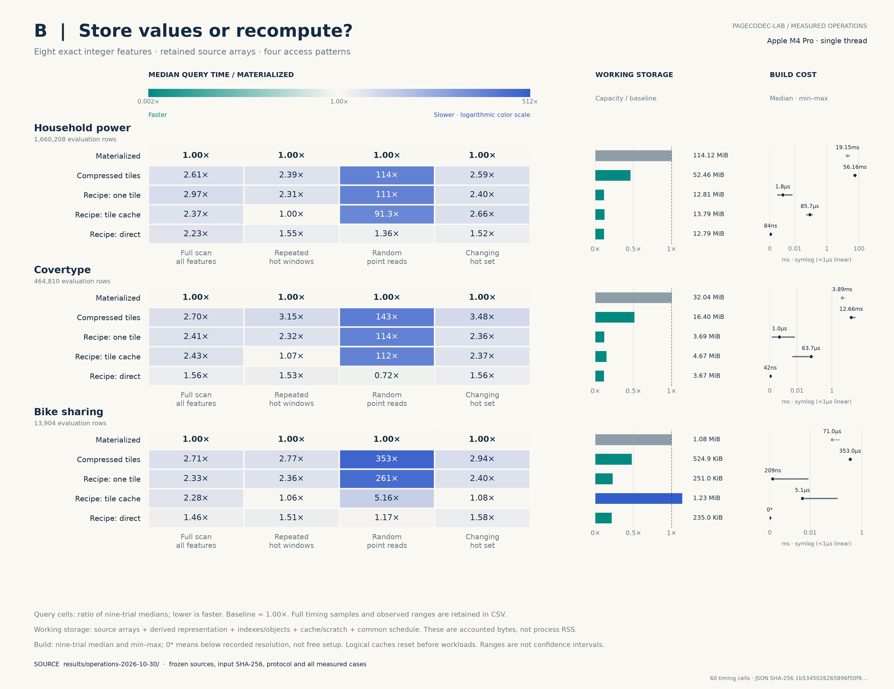
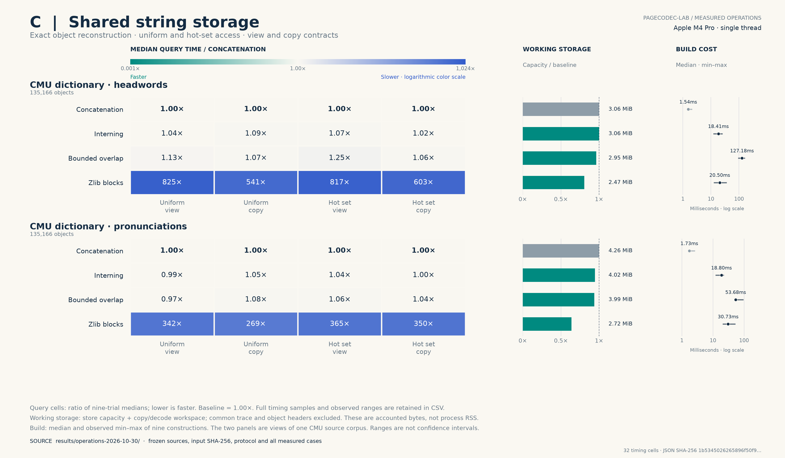

# Beyond whole-page compression: three measured experiments

**Follow-up:** the [complete report application](END_TO_END.md) now measures
source reading, parsing, construction, output and actual peak RSS. It adds
stronger raw/sorted controls and an offline streaming sweep. The latter meets
the full-task time-and-memory criterion on two sources; the bitplane variants
do not. The measurements below remain the original warm-operation experiment.

This follow-up implements three hypotheses from the [research review](RESEARCH.md):
query exact compressed values directly, retain deterministic recipes instead of
derived arrays, and share overlapping immutable strings. All are application
representations with explicit APIs. The original page codec and its published
Apple comparisons remain frozen.

## Results: a useful query path, two narrower trade-offs

The completed run contains **254 method/workload results, 2,286 timed samples
and 41 isolated process-memory probes**. These are repeated observations in one
desktop session, not 2,286 independent experiments. All correctness checks passed.

### A. Bitplanes can make this query faster and smaller

The table reports actual accounted capacity, including explicit scratch, against
the native NEON raw baseline. Speedup is `raw median / method median`; below 1
means slower. Each range covers **all nine** threshold/window scenarios for that
method and source. Eager and progressive share the same representation.

| Source and method | Working capacity / raw | Speedup range | Scenarios with ≥10% lower time |
|---|---:|---:|---:|
| Household, eager | 47.81% | 0.65–3.34× | 6 / 9 |
| Household, progressive | 47.81% | 0.43–3.67× | 7 / 9 |
| Household, adaptive | 48.20% | 0.97–4.40× | 8 / 9 |
| Covertype, eager | 44.51% | 0.97–1.73× | 7 / 9 |
| Covertype, progressive | 44.51% | **1.18–2.00×** | **9 / 9** |
| Covertype, adaptive | 44.90% | 1.01–1.83× | 7 / 9 |
| Bike, eager | 41.17% | 1.05–1.41× | 4 / 9 |
| Bike, progressive | 41.17% | 0.90–1.52× | 4 / 9 |
| Bike, adaptive | 41.60% | 0.98–1.43× | 4 / 9 |


The clearest repeatable-within-run pattern is Covertype progressive: **1,656,816
accounted bytes versus 3,722,184**, with lower median time in every scenario.
This means nine winning workload medians, not nine winning trials in each
workload: it wins 73 of the 81 paired rounds, with 7–9 wins per scenario.
The serialized logical representation is smaller still (1,456,368 bytes); using
capacity avoids hiding vector spare space. The peak process RSS goes the other
way: 8,355,840 versus 5,111,808 bytes in the isolated probes, because construction
and validation also retain the raw inputs. This is not a measured 55.5% RSS saving.

Construction is a real cost: 7.436 ms for Covertype bitplanes versus 0.359 ms for
the raw min/max index. At the low threshold, a full scan takes 0.051541 versus
0.083834 ms. A simple `build + executions × median` estimate crosses after
about **220 repeated full scans**, excluding I/O. The one-sample build time and
warm lookup medians make this illustrative, not a guaranteed payback point.

The 4.40× household maximum is a **four-window schedule at threshold 196**,
not a universal speedup. Progressive evaluation regresses to 0.43× on the
household full scan at threshold 462; the fixed adaptive rule helps there but
does not win every scenario. FOR saves space but is much slower in this simple
implementation. Pair RLE expands the accounted capacity to 2.25–2.52× raw and
loses every timing comparison. Both failures remain in the figure and CSV.

Timing variation matters: the household 4.40× ratio of medians corresponds to
only 2.44× as the median of the nine paired speedup ratios. Both statistics and
the count of paired faster trials are published in `timings.csv`; neither is a
confidence bound. Treat isolated large ratios as observations to reproduce.

### B. Recipes save substantial space; materialization usually wins reuse

| Source | Materialized working bytes | Direct recipe bytes | Capacity reduction | Direct-recipe speedup range |
|---|---:|---:|---:|---:|
| Household | 119,664,432 | 13,411,120 | 88.79% | 0.45–0.73× |
| Covertype | 33,595,776 | 3,847,936 | 88.55% | 0.64–1.38× |
| Bike | 1,130,544 | 240,688 | 78.71% | 0.63–0.85× |



The source arrays remain allocated in every method. Savings are expected when
eight int64 derived columns are removed while two int32 source columns remain;
this is a chosen feature pipeline, not evidence that arbitrary application
memory is 89% redundant. Direct recomputation wins one of twelve operation
scenarios by the ≥10% criterion: sparse Covertype reads, at 0.045667 versus
0.063125 ms for a schedule of 4096 reads. That scenario wins only 6/9 paired
rounds and the observed timing ranges overlap, so it is a median observation,
not established superiority. It is slower in the other eleven workload medians.

Construction changes the decision for one-use intermediates. On household data,
materialization takes 19.151 ms before its 8.518 ms full scan; the direct recipe
takes 19.013 ms for the scan with negligible measured setup. Thus the median-based
estimate favors direct computation for one scan, but materialization for two or
more scans. This is an arithmetic estimate from separately measured medians,
not a separately timed combined end-to-end run. Recipe setup can fall below the
clock resolution (including a recorded zero); that does not mean zero work.

The fixed cache is not a general solution. Its hot-window times nearly match
materialized data, but sparse misses can compute thousands of unused values.
On the small Bike source it occupies **114.08%** of materialization's accounted
capacity and is slower in all four workloads. The compressed-tile baseline also
loses all operation timings. The direct scalar control avoids the worst
over-computation but does not remove the cost of repeated arithmetic.

### C. Overlap savings are mostly consumed by the index

| View | Concatenation + copy workspace | Bounded overlap + workspace | Reduction vs concat | Additional reduction vs interning |
|---|---:|---:|---:|---:|
| Headwords | 3,207,600 B | 3,088,531 B | 3.71% | 3.71% |
| Pronunciations | 4,465,976 B | 4,186,862 B | 6.25% | 0.76% |



Every method pays **2,162,656 bytes of object indexes**: 135,166 entries × 16 bytes.
Headwords have no exact duplicates in this projection; interning changes no
stored bytes. Pronunciation interning already captures most of the observed
saving. Overlap adds only 32,118 saved bytes beyond interning on that view.
None of the overlap lookup scenarios improves median time by 10%; headwords
are slower in all four.

Overlap construction costs 127.18 ms for headwords versus 1.54 ms for simple
concatenation; pronunciation construction costs 53.68 versus 1.73 ms. zlib blocks
reduce accounted capacity by 19.41% and 36.18%, but incur roughly 7–12 microseconds
per lookup, versus tens of nanoseconds for direct arenas in this warm, full-byte
consumption benchmark. That comparison includes zlib's internal allocation and
full-block decoding, and excludes a persistent decoded cache. It is evidence
against **this access strategy**, not against compressed string storage generally.

## What to pursue

The strongest lead is an **exact typed query operator** with a compact bitplane
representation and cheap block-level choice of execution path. The data support
further testing against optimized column-store implementations, construction
amortization, updates and actual application traces. They do not yet establish
the research review's broader target of superiority to the best relevant
compressed baseline on independent corpora: FastLanes, LeCo and NeaTS were not
integrated here. A post-hoc choice of the fastest variant per workload is not a
measured deployable policy.

Recipe retention is useful when memory is scarce or an intermediate is used only
once, provided the retained dependencies and recomputation cost are charged.
The bounded string-overlap heuristic is not compelling on this dictionary;
smaller indexes or a genuinely different corpus would need a new experiment.

## Data and protocol

The numeric experiments use 2,138,922 evaluation rows across three independent
real sources: household electricity readings, forest observations (Covertype),
and hourly bicycle rental counts. Each source contributes two exact int32
columns. Its first 20% of rows calibrate predicate thresholds; only the last 80%
are evaluated, in source order. The string experiment uses 135,166 CMU dictionary
records, separately testing the headword and pronunciation fields. Those two
fields are **one source corpus**, not two independent datasets.

[Data specification](DATASETS.md) · [pinned source/projection hashes](../manifests/operations-v1.json)
· [attribution](../DATA_LICENSES.md).

The runner verifies input hashes and records source and executable hashes before
timing. All eight cases run sequentially on one Apple M4 Pro desktop with 24 GiB
RAM, macOS 15.1.1, Apple clang 16, optimized C++17/C11 builds. Each operation has
nine timed samples with shuffled method order. Query A batches repeated warm
schedules; string C warms 256 lookups and randomizes workload order. Recipe B
has no separate warmup, retains all nine samples and resets logical caches
before each workload. Hardware caches and allocator state are not flushed.
This is one machine session, not a distribution of independent experiments.

Every method receives the same values and requests within a comparison. Source
I/O and correctness oracles are excluded from operation timing. Representation
construction is reported separately: one sample in A, nine samples in B/C.
Results consume their outputs and check them against independent source
answers; compressed representations additionally reconstruct and verify values
or objects outside timing. The tests cover missingness, signed limits, partial
blocks, empty strings and all residual widths. Checksums detect mistakes but
are not proofs; the arithmetic argument and byte/value checks supply additional
evidence. Access schedules are synthetic, not recorded application traces.

## What each experiment tests

### A. Exact predicates and masked sums

For a row window and threshold `t`, count valid `x >= t` and sum the corresponding
nonmissing `y` values exactly. The baseline uses native ARM NEON and a block
min/max index. Other methods use horizontal frame-of-reference packing, eager
bitplanes, progressive bitplanes, a fixed histogram-based choice between the
two bitplane paths, or pair run-length encoding. All index/model bytes count.
Three thresholds and three window schedules produce nine scenarios per source.
Small-window schedules contain 16 requests; medium ones contain four; full
scans contain one. Times are **per complete schedule**, not per returned scalar.

Progressive evaluation retains every bit. It stops reading predicate planes
only when the exact comparison is decided. The sum can be evaluated as
`base * popcount(mask) + sum(2^j * popcount(mask & plane_j))` without reconstructing
every integer. These ideas have prior art; this implementation does not establish
algorithmic novelty. The FOR/RLE controls are straightforward implementations,
not FastLanes, LeCo, NeaTS or a commercial column store.

[Implementation, proof sketch and limits](../experiments/query/README.md).

### B. Compute values only when needed

Eight integer features—sum, difference, product, squares, minimum, maximum and
absolute difference—are either materialized, compressed in independent 16 KiB
tiles, recomputed by tile, recomputed with a 1 MiB direct-mapped cache, or
computed directly for only the requested scalars. **Every method retains both
source columns.** Missingness and all valid int32 extremes have exact int64
semantics. No measured source data are discarded.

Workloads cover a full feature scan, repeated hot windows, sparse point reads
and changing hot sets. The direct scalar recipe is essential: it avoids making
the recipe comparison depend on needlessly computing a full tile for one value.
The compressed method uses the frozen custom page codec, not Apple's codec.
The checksum consumer is common to all methods and its work can dominate small
arithmetic features; these are measurements of this operator pipeline.

[Implementation, allocation accounting and crossover model](../experiments/recipe/README.md).

### C. Shared immutable string storage

Compare concatenation, exact interning, interning plus bounded suffix/prefix
overlap, and object-aligned zlib blocks. Every original object keeps its own
offset/length entry and must be reconstructed in original order. Uniform and
90%-hot access traces are each measured under two contracts: borrow a view and
consume every byte, or copy into a caller buffer and consume every byte.

The overlap heuristic checks at most 64 candidates and 256 overlap bytes.
It is inspired by the shortest-common-superstring connection discussed in the
research review. **It does not implement OpenAI's theorem-backed algorithm and
does not inherit a 2-approximation guarantee.** Interning isolates gains already
available from exact duplicates. The index can cost more than the strings.

zlib level 1 blocks target 4096 uncompressed bytes, never split an object, and
fall back to raw when compression expands a block. Each compressed access is
decoded anew; no persistent decoded cache is allowed in this baseline. Its
internal allocation and decode costs are timed. This does not compare all
possible compressed string stores; caching and smaller indexes could materially
change the result.

[Algorithm, contracts and limitations](../experiments/strings/README.md).

## Memory definitions and scope

The published [memory table](../results/operations-2026-10-30/memory.csv) separates
logical size, accounted working capacity and isolated process high-water RSS.
None is interchangeable with OS memory saved:

- A reports conceptual per-method store capacity and reusable scratch. The main
  timing process retains several representations and shares one physical bitplane
  store among three algorithms; those per-method counts are not additive RSS.
- B counts retained inputs, payload, indexes, objects, scratch/cache and common
  query schedule. Only one method state exists at a time. Allocator overhead,
  executable/library pages and report bookkeeping are excluded.
- C counts store/index capacities plus copy/decode buffers; common trace storage,
  C++ object headers and transient zlib internals are separately disclosed or
  excluded. Fields named `resident_*_capacity_bytes` are allocation accounting,
  **not measured resident memory**.

There are 41 separate one-method process probes using macOS `/usr/bin/time -l`.
Their peak RSS includes loading, construction, validation and lookup. It is not
steady-state RSS and those one-trial timings are not used as performance evidence.
The before/after VM and swap snapshots describe the host, not per-method causality.
Construction can temporarily require far more memory than a finished compact
representation. No energy measurement, OS integration, update workload or
multi-machine result is claimed. Small datasets may remain in hardware caches.

## Reproduce and inspect

The new experiments need a C++17 compiler, a C11 compiler, zlib headers/library,
Python 3.9+ and `curl`. They build on macOS and Linux; the published driver records
macOS isolated RSS automatically. The original Apple API comparison remains
macOS-only. On Debian/Ubuntu, zlib development headers are provided by `zlib1g-dev`.

```sh
make test-operations sanitize-operations CC=clang CXX=clang++
python3 scripts/prepare_operations.py
python3 scripts/run_operations.py --output measurements/my-operations-run
python3 scripts/summarize_operations.py --results measurements/my-operations-run
```

The runner refuses a nonempty destination and rejects modified inputs or sources.
To regenerate all three figures, use Python 3.11+ with the pinned Matplotlib
dependency (or an existing environment containing it):

```sh
python3.11 -m venv .venv
.venv/bin/python -m pip install -r requirements-figures.txt
.venv/bin/python scripts/plot_operations.py
```

Use `--results measurements/my-operations-run --output-dir measurements/my-figures`
to render a new run after summarizing it. Figure cells show method time divided
by baseline time (lower is better); the speedup tables above use its reciprocal.

Published raw measurements are retained under
[`results/operations-2026-10-30`](../results/operations-2026-10-30).
[All trial samples](../results/operations-2026-10-30/timing-samples.csv),
[operation medians and observed ranges](../results/operations-2026-10-30/timings.csv),
[construction costs](../results/operations-2026-10-30/construction.csv),
[full JSON](../results/operations-2026-10-30/all-results.json), and
[frozen configuration](../results/operations-2026-10-30/frozen-config.json)
allow inspection beyond the selected narrative. Observed min/max ranges are not
confidence intervals. The figures are generated from these measurements with
Matplotlib; the illustrative repository banner remains separate.

No outcome here establishes a faster general-purpose RAM subsystem or superiority
to Apple's memory compressor. A successful application representation is a useful
engineering lead, not proof of a new DRAM design or a new mathematical result.
