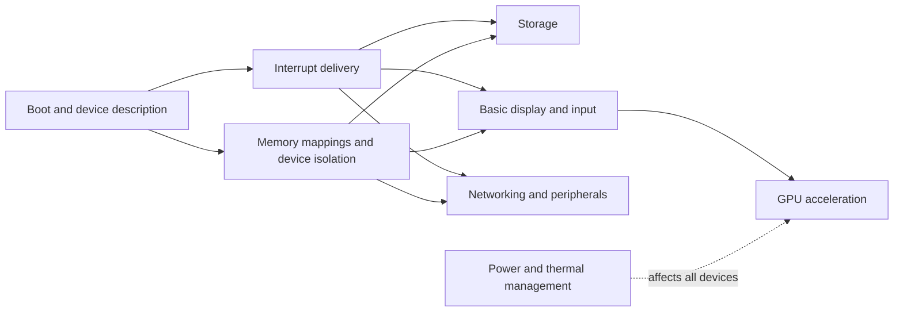

# Open systems and Apple Silicon: evidence map

This document is a starting point for people interested in an open,
Mac-inspired system and Apple Silicon support. It compares what existing
projects say they have built, what remains a goal, and how their work may
inform a new design. Project status is as documented on **30 October 2026**;
we did not independently reproduce their system images or compatibility claims.
Follow the primary links for the latest status. The research machine is an
Apple M4 Pro running macOS 15.1.1.

## Which layer does each project address?

| Project | Layer | Documented result | Material limit |
|---|---|---|---|
| [Apple XNU](https://github.com/apple-oss-distributions/xnu/tree/xnu-11215.41.3) | Kernel | Apple publishes code for memory management, scheduling, Mach/BSD and I/O Kit. | The source tree is not the whole macOS product; live configuration and private components may differ. |
| [PureDarwin](https://github.com/PureDarwin/PureDarwin) | Darwin-based OS | Its [status page](https://puredarwin.org/handbook/status.html) reports a shell on x86-64 and ARM64 virtual machines, `launchd`/XPC, and an x86 desktop on supported hardware. | ARM64 virtual boot is not M4 Pro hardware support. Older Raspberry Pi 3 and iPad 6 boot claims apply to an earlier source tree. |
| [ravynOS](https://github.com/ravynsoft/ravynos) | OS, frameworks and desktop | An open OS project building on Darwin, FreeBSD and new code; its [releases](https://github.com/ravynsoft/ravynos/releases) include a demo VM. | The project describes source and eventual binary compatibility as goals; ARM support is a future target. |
| [Darling](https://github.com/darlinghq/darling) | Application compatibility | A Linux environment with a Mach-O loader, Darwin-like services and framework reimplementations; the project reports many working command-line tools. | It does not supply an independent kernel or M4 drivers. GUI support is under development; [known nonfunctional software](https://docs.darlinghq.org/known-nonfunctional-software.html) documents gaps. |
| [Asahi Linux](https://asahilinux.org/docs/) | Apple Silicon hardware, Linux and drivers | Hardware documentation and drivers, with a distribution for supported machines. | Its [M4 table](https://asahilinux.org/docs/platform/feature-support/m4/) lists no installer for M4 Pro/Max models and marks several essential blocks unfinished. |
| [m1n1](https://github.com/AsahiLinux/m1n1) | Boot and hardware research | Apple Silicon boot and experimentation platform, with documented [hypervisor facilities](https://asahilinux.org/docs/sw/m1n1-hypervisor/). | M4 support has experimental limitations; boot modification is not the same as observing an unchanged system. |
| [Fractal](https://github.com/jprx/fractal) | Microarchitecture research OS | An experimental OS with research-oriented scheduling, privilege and memory-mapping primitives; its [paper](https://fractal-os.com/fractal.pdf) studies Apple Silicon. | It is not a daily-use desktop. Physical M4 instructions are limited to an M4 Mac mini with macOS 15.1 exactly; QEMU does not reproduce physical cache behavior. |

## Useful boundaries and code paths

**A Darwin system base.** PureDarwin assembles XNU, published Darwin userland
and replacement components. Its [source-tree map](https://puredarwin.org/handbook/source-tree.html)
helps locate the kernel, loader, services and desktop. The
[status page](https://puredarwin.org/handbook/status.html) documents a
FreeBSD-driver compatibility layer, networking and graphics on selected
non-Apple hardware. This is a concrete example of adapting an existing driver
ecosystem; it does not make a Linux or FreeBSD driver automatically usable in
another kernel. Its [build instructions](https://github.com/PureDarwin/PureDarwin)
also require an Apple SDK supplied separately.

**Application compatibility.** Darling's [architecture documentation](https://github.com/darlinghq/darling-docs/blob/master/src/internals/darlingserver/README.md)
describes a user-space server that adapts portions of XNU to provide services
normally supplied by the kernel, using cooperative microthreads for some of its
own work. Its [main repository](https://github.com/darlinghq/darling) identifies
the Mach-O loader and framework implementations. The lesson is to identify the
application-facing contracts separately from the kernel implementation; there
is no basis here to claim complete compatibility or zero translation cost.

**Hardware knowledge.** The [Asahi platform documentation](https://asahilinux.org/docs/)
and [m1n1](https://github.com/AsahiLinux/m1n1) provide starting points for
boot, hardware descriptions, interrupts, device isolation and drivers. Their
interfaces were built for a particular software stack and must be assessed
before reuse in another one. Their presence does not mean that the M4 Pro is
fully supported. The [M4 feature table](https://asahilinux.org/docs/platform/feature-support/m4/)
classifies GPU, DART and PCIe as TBA and NVMe as work in progress. These labels
are Asahi's project status, not an exhaustive search for every possible driver.

**Processor research.** [Fractal](https://github.com/jprx/fractal) is useful
for studying mechanisms such as caches and prediction in a research OS. Its
QEMU target can help exercise software interfaces but cannot establish the
behavior or performance of the physical Mac's caches, GPU or devices.

## Driver dependencies to investigate

The following is a planning sketch, not a complete M4 Pro specification:

Each box needs a device-specific interface, source references, known
dependencies, a driver implementation or justified adaptation, and evidence
of correct behavior. Firmware, boot requirements, security mechanisms and
inter-device dependencies need investigation on the specific target. The
diagram does not claim that these arrows exhaust every dependency or prescribe
an installation sequence.

## What could be new here?

One hypothesis is a coordinated resource policy: applications express
latency or energy goals, while system services consider CPU placement, memory
pressure and I/O together within explicit limits. The [architecture sketch](SYSTEM_LANDSCAPE.md)
separates that idea from the projects' documented capabilities. Apple already
has workload groups and scheduling estimates, and other research explores
cross-resource coordination. We have not established novelty or a system-wide
performance benefit. An optional small predictive model would need a bounded
cost and a deterministic fallback, and must preserve isolation and fairness.

The current [compaction experiment](ADAPTIVE_COMPACTION.md) is one user-space
mechanism study, not a working implementation of this operating system. The
[scheduler study](SCHEDULER_RESEARCH.md) exercises an isolated subset of public
Apple source in simulated states, not a modified production scheduler.

## Reuse, provenance and reproducibility

Read each component's own license and its dependencies before combining code.
For example, [Darling](https://github.com/darlinghq/darling) identifies GPL-3.0
and different submodule licenses. [m1n1's license](https://github.com/AsahiLinux/m1n1#license)
distinguishes MIT-licensed historical releases from GPL-2.0-or-later code
starting with version 2.0. The existence of a public source tree does not by
itself grant rights to redistribute Apple's proprietary binaries or SDK.

This repository distributes its own experimental code and records source
links and hashes. The [scheduler fixture](../experiments/scheduler_edge/README.md)
retrieves and checks public XNU source separately; it does not include the
Apple source or kernel binary. We have not installed these projects, modified
the machine's boot chain, or produced an M4 Pro driver.
