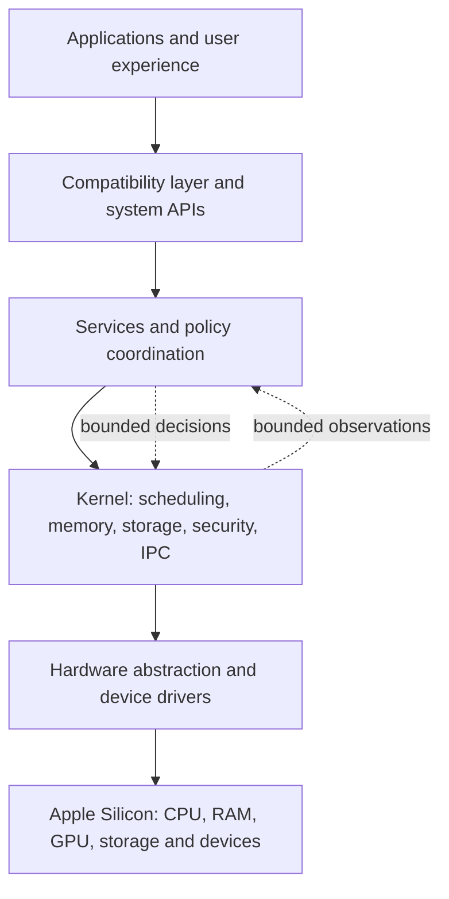

# An alternative system: existing projects and a research sketch

The goal is to understand the machine as a whole and design a coherent
alternative, not to infer that a single microbenchmark improves macOS. This is
an initial source-based landscape and an architectural proposal; it is not an
implemented operating system or proof of compatibility or performance.

For a fuller project-by-project comparison, source links and driver dependency
sketch, see [Open systems and Apple Silicon: evidence map](PROJECT_COMPARISON.md).

## Existing work

| Project | What its own sources describe | What that means for us |
|---|---|---|
| [Apple XNU](https://github.com/apple-oss-distributions/xnu/tree/xnu-11215.41.3) | Public kernel sources including memory, Mach, BSD, I/O Kit and scheduler code. Other macOS components and live platform policies remain outside this source tree. | A primary reference for existing mechanisms, not the entirety of macOS. |
| [PureDarwin](https://github.com/PureDarwin/PureDarwin) | Community effort to extend open-source Darwin into a usable OS. Its [experimental XNU fork](https://github.com/PureDarwin/PureDarwin-XNU) describes x86-64 support. | Study how the open pieces are assembled; do not assume complete macOS or Apple Silicon compatibility. |
| [ravynOS](https://github.com/ravynsoft/ravynos) | An open OS aiming for a familiar experience and some macOS compatibility, building on Darwin, FreeBSD and new code. The README describes x86-64 first and ARM as a future goal. | A whole-system design reference; source and binary compatibility are goals, not proven universal support. |
| [Darling](https://github.com/darlinghq/darling) | A macOS compatibility environment on Linux with a Mach-O loader, a user-space kernel server and reimplemented frameworks. Its documentation describes [the server's use of XNU code and cooperative microthreads](https://github.com/darlinghq/darling-docs/blob/master/src/internals/darlingserver/README.md). GUI support remains under development. | Study compatibility boundaries and their costs; it is not a complete replacement OS. Its GPL and submodule licenses matter if code is reused. |
| [Asahi Linux](https://asahilinux.org/docs/) and [m1n1](https://github.com/AsahiLinux/m1n1) | Apple Silicon hardware documentation, drivers and a boot/experimentation platform supporting a Linux port. | Essential hardware and driver reference; its [M4 support table](https://github.com/AsahiLinux/docs/blob/main/docs/platform/feature-support/m4.md) lists M4 Pro/Max GPU support as TBA and no installer for the listed devices. Do not assume this machine is ready to run it. |
| [Fractal](https://github.com/jprx/fractal) | A separate experimental OS for microarchitecture research, with QEMU and selected Apple Silicon targets. Its physical M4 instructions are limited to M4 Mac mini and macOS 15.1 exactly. | Ideas for studying lower-level processor behavior; its VM target cannot demonstrate physical cache behavior by itself. |

These projects have different goals and are not drop-in components. Their
interfaces, target architectures, maturity and licenses need to be evaluated
before any code or design is combined.

## Drivers are a core part of the project

For this M4 Pro machine, [Asahi's M4 feature table](https://github.com/AsahiLinux/docs/blob/main/docs/platform/feature-support/m4.md)
lists the GPU, DART and PCIe as TBA, while NVMe is work in progress; the
listed M4 Pro/Max models do not have an installer. These labels describe Asahi's
Linux work, not proof that no implementation exists anywhere. They also do not
establish whether a Linux driver can be used unchanged with a different kernel.

The design needs a device inventory and dependency graph: boot and interrupt
delivery; memory mapping and device isolation; storage; basic display and input;
then graphics acceleration, networking, power management and remaining
peripherals. Existing public drivers and documentation are starting points for
analysis or adaptation where their interfaces and licenses allow it; gaps may
require new drivers and hardware research. Each component needs its own
compatibility and reliability evidence. No driver for this proposed system has
been implemented or validated in this study.

## A system-wide research direction

The following is an **unproven design sketch**, informed by those projects, not
a description of an existing implementation:

One possible organizing principle is to coordinate resource decisions around
the *workload* rather than optimize one subsystem in isolation. A workload
could expose declared latency and energy goals; a coordinator could use
bounded, aggregated signals about runnable work, memory pressure and I/O to
make conservative recommendations. Existing kernel mechanisms would enforce
priorities, isolation and resource limits. A small model might propose a
decision, but must have a cheap deterministic fallback and cannot bypass those
constraints. This is an idea, not evidence of a novel mechanism: Apple already
groups work and uses statistical estimates in its scheduler.

Questions that determine whether the idea can work include compatibility with
existing applications, the availability of M4 drivers, safe interfaces between
subsystems, overhead, privacy of observations, responsiveness, fairness, power
and failure recovery. A design can improve one while harming another. The
first concrete deliverable is a more complete architecture and evidence map,
including what is public, inferred and unknown. Only later would a prototype
and appropriate system-wide comparisons establish whether the design helps.
