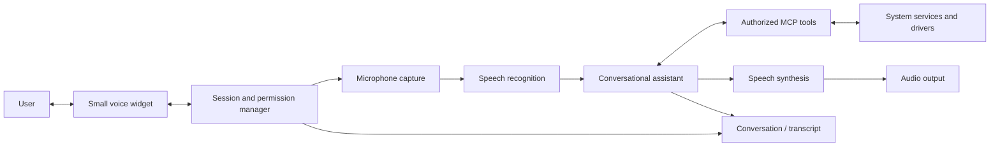

# A voice assistant as part of the operating system

This document describes a proposed user experience and architecture. The
assistant, widget, voice stack and system integrations are not implemented in
this repository. The idea is inspired by the convenience of a small voice
control remaining available while the main conversation window is minimized;
it does not assume ChatGPT's internal implementation or copy its branding.

## User experience

The related [two-workspace proposal](DUAL_WORKSPACES.md) gives the human and
the assistant separate workspaces, pointers and input focus where supported.

During an explicitly started voice conversation, a compact floating widget
could remain near the right edge of the screen even if its main window is
minimized. The user can move or hide it, reopen the conversation, mute the
microphone, interrupt a response or end the session. Clear visual states
distinguish listening, muted, processing, speaking, offline and error. The
widget also needs keyboard access, accessible labels and a visible transcript
when requested. Microphone status is explicit; ending or muting a session must
stop or disable capture as its controls promise. Wake words or always-on
listening are not implied by this design.

This diagram is a proposal; it does not establish which processing runs locally
or remotely. Jev and the local Laya experiment provide structured decisions;
neither on its own is speech recognition, speech synthesis or a complete
conversational model.

## Conversation and system interaction

1. A user explicitly opens a session and grants microphone access. The widget
   exposes capture state, audio device selection and mute/end controls.
2. Audio is recognized using a selected speech-to-text implementation. The
   text and appropriate session context go to the conversational assistant.
3. When a request requires a system operation, the assistant consults the
   [proposed MCP control plane](AI_CONTROL_PLANE.md). The system enforces
   identity, scope, user-configured permissions and operation limits.
4. The assistant presents the result and optionally reads it through
   text-to-speech. Interrupting speech or canceling a request needs explicit
   semantics; cancellation does not imply an already-started system operation
   was rolled back.

Local and remote processing should be distinguishable in the UI and user
configuration. If recognition or synthesis uses a network service, the user
should know what is sent. Retention of audio, text and audit records needs a
clear policy. Device loss, unavailable models and denied permissions should
produce understandable states and usable fallback paths; the OS must not
depend on the voice assistant for normal operation.

## Implementation boundaries

For a future macOS prototype, AppKit documents [floating panels](https://developer.apple.com/documentation/appkit/nspanel/isfloatingpanel)
and [focus behavior](https://developer.apple.com/documentation/appkit/nspanel/becomeskeyonlyifneeded).
Behavior across window minimization, full-screen applications, multiple
displays and Spaces would still need to be verified on the target macOS
version. Apple's [speech recognition APIs](https://developer.apple.com/documentation/speech/sfspeechrecognitionrequest)
include a request for on-device recognition where supported; this does not
guarantee that every language or device supports it.

For a new OS, the widget would additionally depend on an implemented window
manager, compositor, audio capture/output, permissions, speech engines, and the
MCP-facing system services. The M4 Pro driver gaps in the [project comparison](PROJECT_COMPARISON.md)
therefore remain relevant. End-to-end voice responsiveness, interruption delay,
model resource use, battery impact and accessibility would need measurement.
