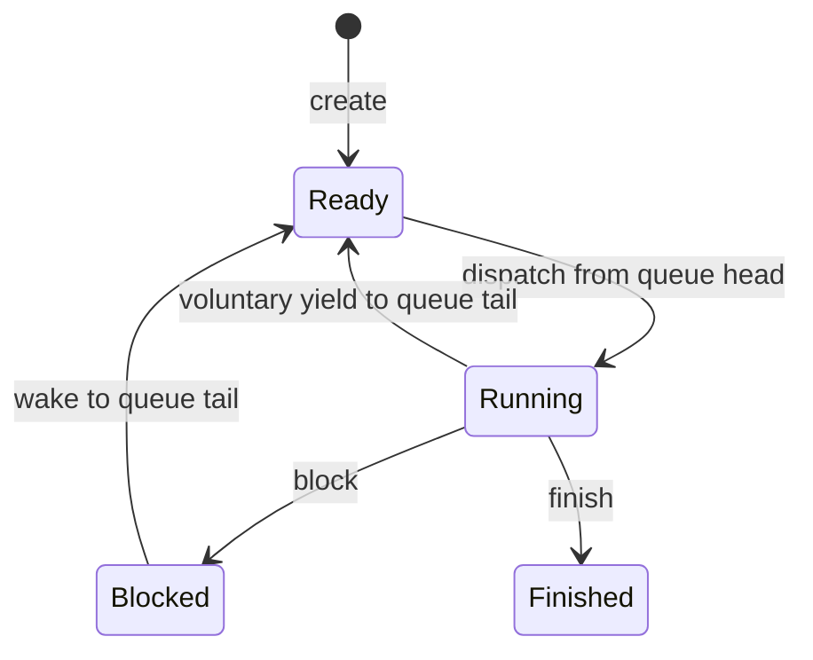

# Cooperative scheduler state model

`scheduler-core-sketch` is a Rust `no_std` + `alloc` library for a **single logical runner**. It tracks tasks by nonzero numeric ID and maintains a FIFO ready queue plus at most one selected running task. Task IDs remain reserved after completion; capacity is limited by memory rather than a fixed API maximum.



Selection while another task is marked running is rejected. Yield, block and finish require a running task; waking requires an existing blocked task. Duplicate IDs and invalid transitions are rejected. When no task is ready and none is running, dispatch returns `None`. A woken task joins the end of the queue. Under the assumption that running tasks eventually yield, block or finish, FIFO selection gives already-ready tasks turns in queue order; there is no preemption or bound on real-world waiting time.

**This does not run multiple processes or perform context switches.** It does not save registers or stacks, access a timer, interrupt a task, schedule across CPUs, implement priorities, authorize actors, persist state or connect to the other experiments. It is not integrated into a kernel, and no performance gain over macOS is claimed. The caller must serialize access, provide an allocator in a `no_std` environment, and decide how to handle allocator exhaustion. There is no removal API for completed records and no recovery from allocation failure in this sketch.

## Reproduce the QEMU guest scenario

With Rust target `aarch64-unknown-none-softfloat`, QEMU AArch64 and Python 3:

```sh
cargo build --release --locked --features qemu-demo
python3 run_demo.py --qemu /path/to/qemu-system-aarch64 \
  --guest target/aarch64-unknown-none-softfloat/release/scheduler-core-demo \
  --output-dir /path/to/output
```

The one-CPU QEMU guest uses synthetic task IDs and calls the library directly; its fixed, non-reclaiming 128 KiB allocator limits this demo. It checks two cycles of selections `1,2,3,1,2,3`, blocking and waking, finishing, empty queue, IDs and invalid transitions. These are decisions by one test function, not independently executing tasks. There are no guest disks, network or shared host directories. The harness records guest hash and QEMU version; do not rebuild the guest while it runs. See the [synthetic QEMU evidence](evidence/scheduler-core-evidence.json).
